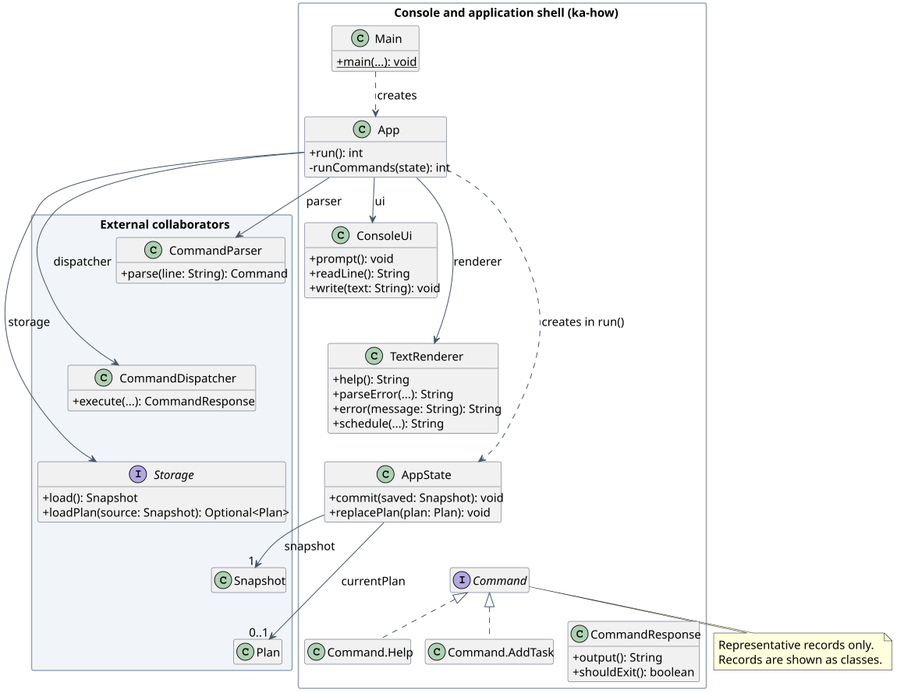
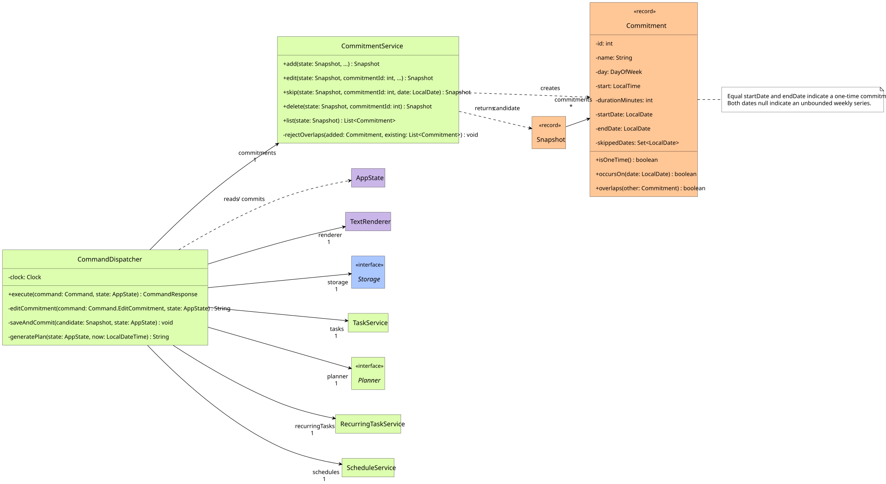
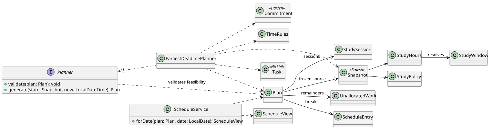
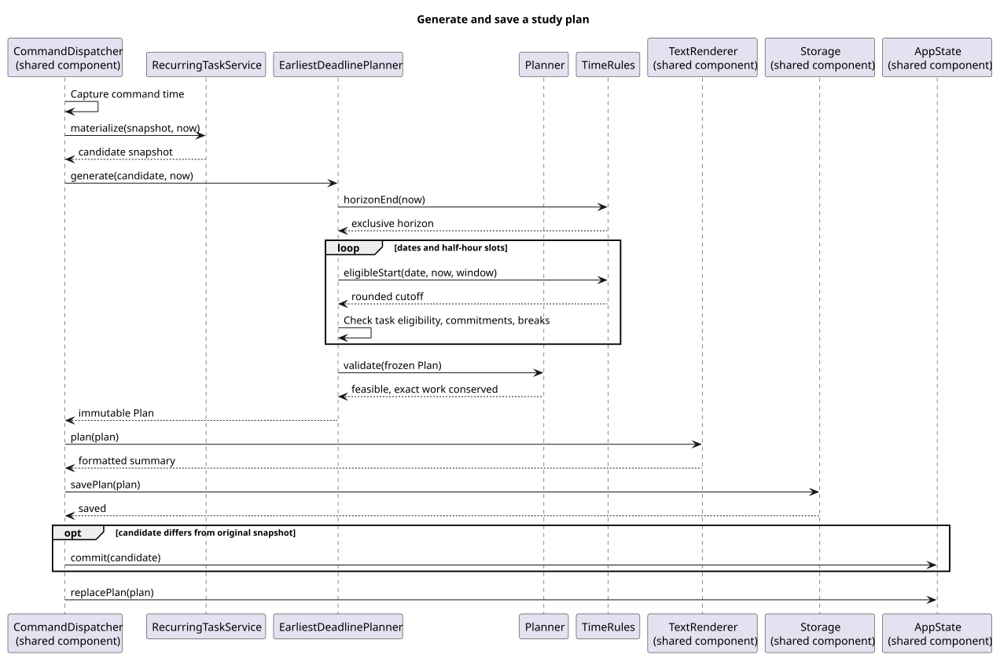
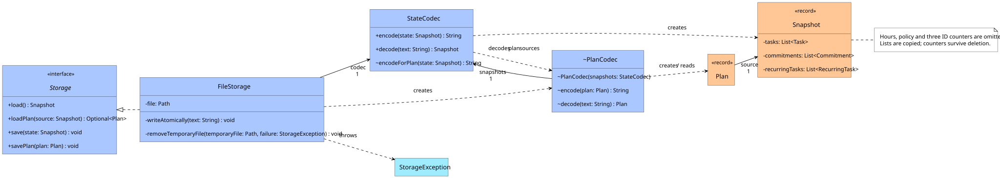
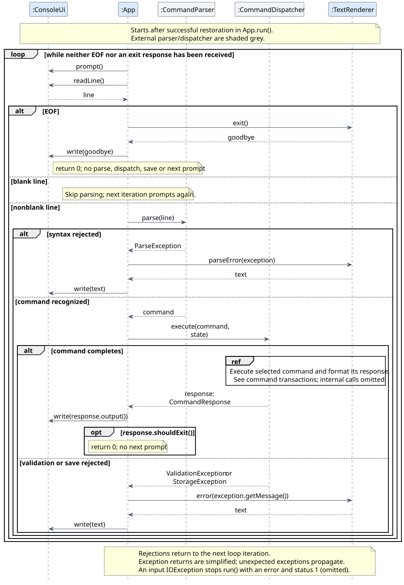
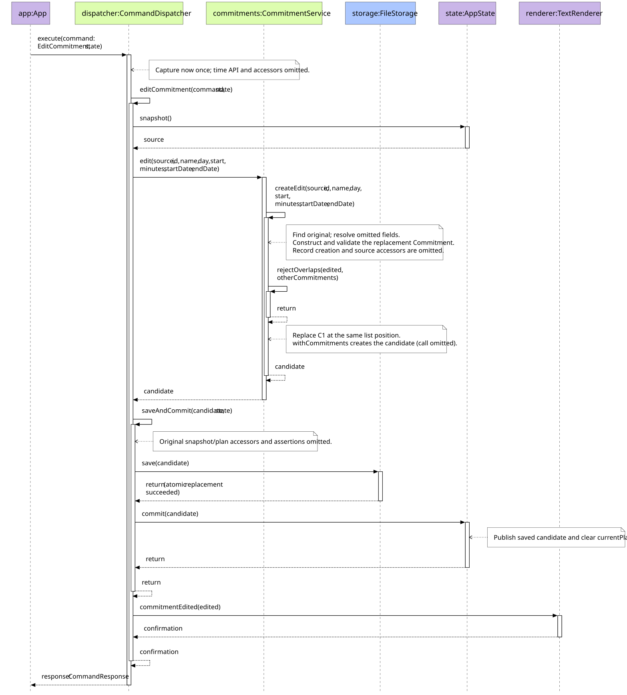
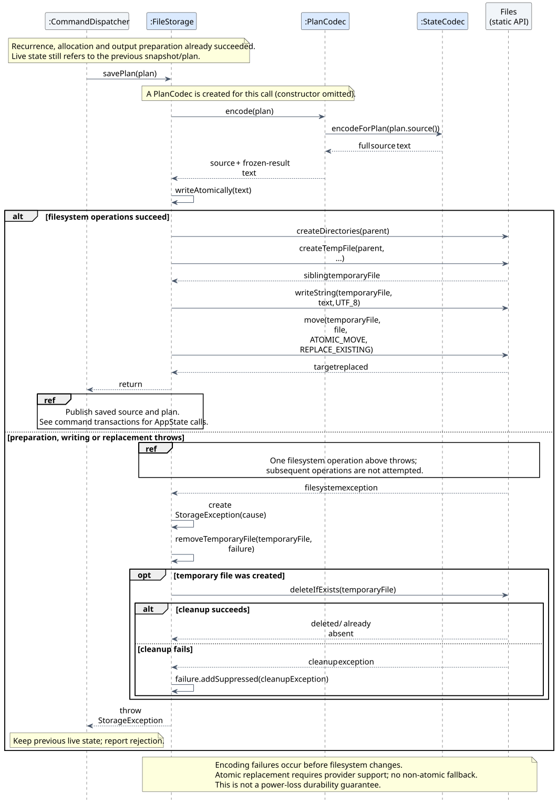

# Developer Guide

ScheduleFlow is a Java 25 console application for university students planning
coursework around fixed commitments. For commands and user examples, see the
[User Guide](UserGuide.md).

## Contents

- [Acknowledgements](#acknowledgements)
- [Setting up, getting started](#setting-up-getting-started)
- [Design](#design)
  - [System overview and collaboration boundaries](#system-overview-and-collaboration-boundaries)
  - [Console application and presentation](#console-application-and-presentation)
  - [Task model and command parsing](#task-model-and-command-parsing)
  - [Commitments and command execution](#commitments-and-command-execution)
  - [Planning, schedule projection and recurrence](#planning-schedule-projection-and-recurrence)
  - [Persistence and the Snapshot aggregate](#persistence-and-the-snapshot-aggregate)
- [Implementation](#implementation)
  - [Recoverable console interaction and deterministic rendering](#recoverable-console-interaction-and-deterministic-rendering)
  - [Exact task work and retained task lifecycle](#exact-task-work-and-retained-task-lifecycle)
  - [Dated commitments and save-before-publication dispatch](#dated-commitments-and-save-before-publication-dispatch)
  - [Slot allocation under study hours/policy and recurrence](#slot-allocation-under-study-hourspolicy-and-recurrence)
  - [Atomic persistence and restoring frozen plans](#atomic-persistence-and-restoring-frozen-plans)
- [Documentation, logging, testing and dev-ops](#documentation-logging-testing-and-dev-ops)
- [Appendix A: Product Scope](#appendix-a-product-scope)
- [Appendix B: User Stories](#appendix-b-user-stories)
- [Appendix C: Non-Functional Requirements](#appendix-c-non-functional-requirements)
- [Appendix D: Glossary](#appendix-d-glossary)
- [Appendix E: Instructions for Manual Testing](#appendix-e-instructions-for-manual-testing)
  - [Launch, help, exit and console behavior](#launch-help-exit-and-console-behavior)
  - [Tasks and input validation](#tasks-and-input-validation)
  - [Commitments and unavailable periods](#commitments-and-unavailable-periods)
  - [Planning, schedules, hours, policy and recurrence](#planning-schedules-hours-policy-and-recurrence)
  - [Saving, restoration, failure and recovery](#saving-restoration-failure-and-recovery)

## Acknowledgements

ScheduleFlow uses [Gradle](https://gradle.org/) and the
[Shadow plugin](https://gradleup.com/shadow/) to build and package its executable
JAR, [JUnit 5](https://junit.org/junit5/) for Java tests, and
[Checkstyle](https://checkstyle.org/) for automated style checks. Dependency
versions are recorded in [`build.gradle`](../build.gradle) and the
[Gradle wrapper configuration](../gradle/wrapper/gradle-wrapper.properties).
These are development tools; ScheduleFlow does not call their websites while
managing a student's data.

This guide adapts the organization and enhancement-explanation pattern of the
[AddressBook Level 3 Developer Guide](https://se-education.org/addressbook-level3/DeveloperGuide.html).
That credit concerns documentation structure; the console design described here
uses ScheduleFlow's actual classes. The UML figures use
[PlantUML](https://plantuml.com/) and the
[SE Education PlantUML tutorial](https://se-education.org/guides/tutorials/plantUml.html).
The repository's local skills record the
[SE Education Java conventions](https://se-education.org/guides/conventions/java/intermediate.html),
[Git conventions](https://se-education.org/guides/conventions/git.html), and
[CS2113 code-quality guidance](https://nus-cs2113-ay2627-s1.github.io/website/se-book-adapted/chapters/codeQuality.html)
used during development.

The [code-authorship allocation](#code-authorship) identifies maintenance
responsibilities. Reassigned whole-file tags do not establish who originally
implemented an enhancement; Git history retains that provenance. Before release,
contributors must supply credits for any additional copied or adapted material
so its source and extent can be acknowledged accurately.

## Setting up, getting started

Import the repository into IntelliJ as a Gradle project and select SDK 25.
Keep Java source encoding at UTF-8. Use the committed Gradle wrapper; Node.js
22 or later is needed for process tests, not for running the application.
See [build and verification](#build-packaging-and-console-verification) for
commands and [manual testing](#appendix-e-instructions-for-manual-testing)
for isolated JAR launches.

## Design

The following views separate responsibilities in the existing packages; the
Implementation section traces the workflows that connect them.

### System overview and collaboration boundaries

| Area | Main entry points | Code owner |
| --- | --- | --- |
| Application shell and presentation | `Main`, `App`, `AppState`, `ConsoleUi`, `TextRenderer`, `Command`, `CommandResponse` | Ka How (`ka-how`) |
| Tasks and all command parsing | `TaskService`, `TaskEdit`, `Task`, `CommandParser`, `ParseException`, shared validators | Nickhil (`nickpatt`) |
| Commitments and all command dispatch | `CommitmentService`, `Commitment`, `CommandDispatcher` | Darren (`Darren50`) |
| Planning, hours, policy and recurrence | `planning/`, `StudyHours`, `StudyWindow`, `RecurringTaskService`, `RecurringTask`, `TaskOccurrence` | Gabriel (`GabrielYuSP`) |
| Persistence and aggregate validation | `storage/`, `Snapshot` | Ernest (`ernestgoh-god`) |

#### Code authorship

The whole-file `@@author` tags and the agreed version 2 allocation define
ownership, including nested types and helpers. Cross-component calls do not
split ownership. Tags record the allocation, not historical authorship. See
[source ownership](../src/main/java/scheduleflow/AGENTS.md),
[test ownership](../src/test/AGENTS.md) and the
[RepoSense tag reference](https://reposense.org/RepoSense/ug/usingAuthorTags.html).

### Console application and presentation

The shell connects text interaction to the domain without putting console I/O
inside services. The class view shows Ka How's seven production types and the
external collaborators needed to understand the command path. Associations
denote retained references; dashed dependencies denote creation or use.
`...` marks omitted parameters. Service, codec, clock and transport-use
dependencies are omitted to keep this view focused.



[PlantUML source](diagrams/ka-how-console-classes.puml)

[`Main`](../src/main/java/scheduleflow/Main.java) supplies UTF-8 streams,
`Clock.systemDefaultZone()` and `FileStorage` for `data/scheduleflow.txt` relative
to the launch folder. It creates `App` and turns its returned status into process
termination. `App` receives `Storage`, `Clock` and `ConsoleUi`, then constructs
the parser, renderer and dispatcher with their services. Constructors do no I/O;
loading begins in `run()`. `AppState` is local to that run, rather than an `App`
field, so command execution receives the session's live state explicitly.

[`ConsoleUi`](../src/main/java/scheduleflow/cli/ConsoleUi.java) owns line reads,
prompt/response writes and flushing.
[`TextRenderer`](../src/main/java/scheduleflow/cli/TextRenderer.java) returns
formatted text; it does not read the clock, perform console I/O or mutate state.
[`AppState`](../src/main/java/scheduleflow/cli/AppState.java) retains a `Snapshot`
and an optional matching `Plan`. `commit(saved)` publishes a saved candidate and
clears the plan. `replacePlan(plan)` accepts an equal source snapshot, rejecting
a stale source before changing state, even with assertions disabled.

[`Command`](../src/main/java/scheduleflow/cli/Command.java) is a sealed interface
whose nested records carry requests, for example `Help`, `AddTask` and
`ScheduleToday`. These values have no execution method: syntax belongs to
Nickhil's parser and domain rules to the services. `CommandResponse(output,
shouldExit)` carries the dispatcher's formatted result and termination decision
back to `App`. The diagram shows only representative records; the two unavailable
range transports exist but their console routes remain unfinished.

### Task model and command parsing

`TaskService` returns immutable mutation candidates. `Task`, `TaskPriority`,
`TaskEdit` and `InputRules` express task structure and validation.
`CommandParser` converts input to the nested `Command` records without
reading time, state or storage; `ParseException` carries the usage hint.

### Commitments and command execution

This component has two jobs. It models the student's fixed commitments, and it
executes every parsed command as one transaction: validate, save, then publish.
The class view shows Darren's three production types and the collaborators the
dispatcher holds. Solid arrows are retained references; dashed arrows are use or
creation. Other members' types are shaded and labelled with their owners.



[PlantUML source](diagrams/darren-commitment-dispatch-classes.puml)

| Type | Responsibility |
| --- | --- |
| [`Commitment`](../src/main/java/scheduleflow/model/Commitment.java) | Immutable record of one fixed commitment. Its compact constructor validates the name, half-hour start, positive 30-minute-multiple duration, same-day end, date range and skipped dates. `occursOn(date)` and `overlaps(other)` are the only calendar-membership and conflict rules used elsewhere. |
| [`CommitmentService`](../src/main/java/scheduleflow/commitment/CommitmentService.java) | Stateless operations (`add`, `edit`, `skip`, `delete`, `list`) that take a `Snapshot` and return a new candidate `Snapshot` or an ordered view. It never saves, publishes or reads the clock. |
| [`CommandDispatcher`](../src/main/java/scheduleflow/cli/CommandDispatcher.java) | Routes each nested `Command` record to one handler, captures the command time once, and owns the save-before-publication transaction for every mutating command, not only commitments. |

A `Commitment` takes one of three shapes, all stored in the same record:

| Shape | `startDate` / `endDate` | Occurs on |
| --- | --- | --- |
| Unbounded weekly series | both `null` | every `day` |
| Bounded weekly series | ordered dates containing `day` | every `day` within the inclusive range |
| One-time commitment | equal dates | that single date (its `day` is derived from it) |

Weekly shapes may also hold `skippedDates`, which `occursOn` excludes. Two
commitments overlap only when their times intersect, they share a weekday and
at least one unskipped date falls in both. This lets separate semesters reuse
a time slot while still rejecting real clashes.

The dispatcher separates three steps that other components keep apart too.
A service validates and returns a candidate, but nothing changes yet. `Storage.save`
then makes the candidate durable, using Ernest's [atomic persistence](#atomic-persistence-and-restoring-frozen-plans).
Only after that does `AppState.commit` publish it and clear the now-stale plan.
The dispatcher reuses other members' services rather than duplicating their rules:
task changes come from Nickhil's `TaskService`, recurring occurrences and plans
from Gabriel's `RecurringTaskService` and `Planner`, and output text from Ka How's
`TextRenderer`. Importing those types does not make them part of this component.

### Planning, schedule projection and recurrence

`EarliestDeadlinePlanner` creates chronological half-hour slots from the
captured command time through the rolling calendar-year horizon. It excludes
recurring commitments, skips zero-remaining completed tasks, sorts dated tasks by
deadline, priority then numeric ID, followed by undated tasks by priority/ID, and assigns
each eligible task to its earliest free slots. Overdue and out-of-horizon
tasks keep their full work estimate as unallocated; eligible tasks retain any
sessions that fit before their deadline. Undated tasks use the same finite horizon
without overdue/outside-horizon classification. Adjacent slots for one task merge
within a day. Source task estimates remain unchanged.

`ScheduleService` projects the frozen plan across the complete configured daily
window. Each slot is classified as busy, assigned to a task, reserved for a
break, before the generation cutoff, or free, in that order. Merging preserves
commitment and task identities. `Plan`, `StudySession`, `UnallocatedWork`, `ScheduleEntry` and
`ScheduleView` validate their own fields and retain immutable result lists;
allocation relationships remain the planner's responsibility. Fixed-date
planner and projection tests verify deadline order, conservation of minutes,
cutoff rounding, clipping, midnight commitments and allowed schedule dates.

`Planner.validate(Plan)` is the pure cross-record boundary. It checks the frozen
source and generation time, not the current clock, without regenerating work.
`EarliestDeadlinePlanner.generate` calls it before returning every result.
Storage integration is assigned to Ernest and remains pending until his codecs
call this boundary; raw `Plan` construction retains its lightweight contract.

`Planner` is implemented by `EarliestDeadlinePlanner`. `TimeRules` defines
cutoff and horizon calculations. `StudyHours`/`StudyWindow` supply daily
availability and `StudyPolicy` supplies optional work/break limits. The
dispatcher calls `RecurringTaskService` before planning; the allocator does
not generate templates or occurrences itself.

Study hours and optional policy come from the plan's source snapshot. A date
override takes precedence over weekday hours, which take precedence over the
default. Recurrence is prepared outside the planner: the dispatcher asks
`RecurringTaskService` to materialize a candidate before calling
`Planner.generate`. The planner uses each occurrence's original release time
and has no dependency on recurrence, storage or the live clock. A recurrence
template owns its stable R ID, weekly deadline pattern, optional inclusive end
date and processing cursor. Each generated task retains its template ID and
original deadline, from which its one-week release is derived. Advancing the
cursor past missed dates prevents backfilling and recreation after restart or
deletion of a generated task.

The class view focuses on the planner and daily schedule projection boundaries.
`Task` and `Commitment` are source records owned by their respective modules;
`Snapshot` is the aggregate owned by the persistence component. Arrows show
dependencies or contained results, not ownership of those external types.



[PlantUML source](diagrams/gabriel-planning-classes.puml)

Generation first classifies unfinished work: overdue and beyond-horizon tasks
retain their full remainder; other work competes for chronological slots.
Dated tasks are ordered by deadline, priority and numeric ID, followed by
undated tasks ordered by priority and ID. A slot must fit wholly inside that
date's study window, start after the rounded generation cutoff and any
occurrence release, end no later than the task deadline, and not overlap a
fixed commitment. Required breaks reserve capacity too.

For example, at Monday 10:07 with an 08:00-22:00 window, a 10:00-10:30 class
and a 90-minute task due at 11:30, the rounded cutoff is 10:30. The task gets
the two remaining slots through its deadline: 60 minutes scheduled and 30
reported as insufficient capacity. Its source estimate remains 90 minutes.
This earliest-deadline greedy policy is predictable and gives earlier
deadlines first access to scarce time; it does not optimize for fewest sessions
or most fully completed tasks.

The sequence view follows a successful `plan` command from time capture through
plan publication. The planner computes the horizon once and the daily cutoff
for each date; it then evaluates half-hour slots. The dispatcher renders and
saves the plan before publishing the candidate snapshot and current plan.



[PlantUML source](diagrams/gabriel-planning-sequence.puml)

### Persistence and the Snapshot aggregate

This section describes the current source implementation, not the older v1.0
JAR. The persistence boundary separates
filesystem access, text conversion and aggregate validation:

| Type | Responsibility |
| --- | --- |
| [`Storage`](../src/main/java/scheduleflow/storage/Storage.java) | Defines complete snapshot and frozen-plan loading/saving contracts for the application. |
| [`FileStorage`](../src/main/java/scheduleflow/storage/FileStorage.java) | Resolves one target path, reads UTF-8 and replaces that file atomically. Construction performs no I/O. |
| [`StateCodec`](../src/main/java/scheduleflow/storage/StateCodec.java) | Converts versioned source records without opening files. |
| [`PlanCodec`](../src/main/java/scheduleflow/storage/PlanCodec.java) | Converts a frozen result together with its complete source; it is package-private. |
| [`Snapshot`](../src/main/java/scheduleflow/model/Snapshot.java) | Copies lists and validates the complete persisted aggregate. |
| `StorageException` | Reports rejected loads/saves while retaining underlying causes where available. |



[PlantUML source](diagrams/ernest-storage-classes.puml). Dashed arrows denote use;
solid arrows denote retained references. The external `Plan` is shaded; other
model dependencies appear as field types, without transferring their ownership.

`Snapshot` retains tasks, commitments, study hours, recurring templates, optional
policy and three independent next-ID counters. Its validation rejects duplicate
IDs, counters not above retained IDs, overlapping commitments and inconsistent
occurrence provenance/cursors. Validated hours/policy values must be present in
their required containers. Retained provenance may refer to a deleted template,
provided its allocated ID remains below the next R counter. Lists retain their
order and are immutable; deleting all records does not reset counters.

A `Snapshot` is source data. A `Plan` additionally freezes generation time,
sessions, unallocated work and breaks against that source. Ka How's `AppState`
holds the session's live snapshot and optional plan; storage neither publishes
that state nor invokes the planner.

## Implementation

These sections describe the important state transitions and failure
boundaries. Proposed console operations are explicitly labelled.

Each section traces one enhancement and links to the others instead of
repeating them. A typical mutating command crosses all five:

1. [Console interaction](#recoverable-console-interaction-and-deterministic-rendering)
   reads and parses the line and later prints the response.
2. [Task lifecycle](#exact-task-work-and-retained-task-lifecycle),
   [commitment](#dated-commitments-and-save-before-publication-dispatch) or
   [planning](#slot-allocation-under-study-hourspolicy-and-recurrence) services
   validate it and return a candidate.
3. The [dispatcher transaction](#command-dispatch-and-live-state-transactions)
   saves the candidate before publishing it.
4. [Atomic persistence](#atomic-persistence-and-restoring-frozen-plans) makes that
   save all-or-nothing.

### Recoverable console interaction and deterministic rendering

A mistyped command should leave the student able to correct it in the same
session. The shell implements this by distinguishing recoverable command
failures from failures that prevent the session from continuing. Its starting
points are [`App.run()` and `runCommands()`](../src/main/java/scheduleflow/cli/App.java).

#### Startup and the command loop

`run()` calls `Storage.load()`, creates `AppState`, and requests
`Storage.loadPlan(loaded)`. A returned plan is checked through `replacePlan`.
Neither restoration nor rendering regenerates the schedule. A `StorageException`
during either load produces `TextRenderer.error(message)` and status 1 before
any prompt or command read. Starting empty is allowed only for a genuinely
missing store; corrupt data must not be silently replaced. File validation and
atomic replacement are explained in [persistence](#atomic-persistence-and-restoring-frozen-plans).

After successful startup, each iteration flushes the exact `scheduleflow> `
prompt, calls `ConsoleUi.readLine()`, and handles one complete line. Blank input
immediately begins the next iteration, without parsing, dispatching or saving.
For a nonblank line, the parser returns a `Command`; the dispatcher executes it
against the same `AppState`. `ConsoleUi.write(response.output())` adds the final
newline and flushes the response before `shouldExit()` is inspected.



[PlantUML source](diagrams/ka-how-command-loop.puml)

The diagram starts after restoration. Its success formatter is shorthand for
the method selected by the dispatcher (`help`, `taskAdded`, and so on).
Service calls, storage operations and publication are omitted; their ordering
is described in [command transactions](#command-dispatch-and-live-state-transactions).

For example, after adding `commitment add n/Lecture day/MON start/1000 d/60`
to an empty store, parsing supplies `Command.AddCommitment`. The dispatcher
obtains a candidate, saves and publishes it, then calls
`TextRenderer.commitmentAdded`. Only the returned `CommandResponse` reaches the
console. Entering the same overlapping commitment again yields a validation
error and another prompt. Correcting the interval to start at `1100` succeeds
with C2; the rejected attempt consumed no ID. The shell owns the interaction,
while the service and dispatcher establish candidate validation and rollback.

#### Failure boundaries and termination

| Event | Shell behavior | Session outcome |
| --- | --- | --- |
| `ParseException`, for example `help extra` | `parseError` prints `Error: MESSAGE` and `Expected: USAGE`; dispatch is not reached. | Next prompt. |
| `ValidationException`, for example an overlapping commitment | `error` prints one explanation; no success response is written. | Next prompt. |
| `StorageException` during command execution | `error` reports the rejected save; the dispatcher retains the previous live state and plan. | Next prompt; the user can retry. |
| `exit` | The dispatcher returns goodbye with `shouldExit = true`; `App` prints it once. | Status 0, no extra save or prompt. |
| EOF (`readLine()` returns `null`) | `App` writes `TextRenderer.exit()` without invoking parser or dispatcher. | Status 0, no save. |
| Input `IOException` | `run()` prints `Error: Cannot read input: MESSAGE`. | Status 1. |

Unexpected programming exceptions propagate. In particular, a null dependency
or a stale plan is not converted to an ordinary input error. (The unfinished
range routes deliberately throw `ValidationException`, so they are reported as
ordinary errors.) Extra process arguments are rejected by `Main` before loading,
with `Error: Usage: java -jar scheduleflow.jar (no arguments)` and status 1.
`App` returns status codes so tests and embedded callers need not terminate
their JVM; only `Main` calls `System.exit`.

#### Deterministic presentation

Renderer methods return LF-separated strings with no trailing newline.
`ConsoleUi` supplies the final platform newline; tests normalize CRLF only at
the process boundary. Explicit UTF-8 streams in `Main` preserve names such as
`学习 Café` even when the JVM's default encoding differs. Date/time formatters use
`uuuu-MM-dd`, `uuuu-MM-dd HH:mm` and `HH:mm` with `Locale.ROOT`; weekday labels
explicitly use English. Validated commitment endpoints at midnight display as
`24:00` instead of wrapping to `00:00`.

Formatting preserves the supplied task order and schedule entry boundaries.
Weekly commitments are grouped Monday to Sunday, followed by one-time entries
ordered by date; within each group the service's supplied ordering is retained.
The renderer does not allocate, clip or merge sessions. `schedule(view)` uses
the view's frozen generation time and rows, adds a cutoff note if UNPLANNED
appears, and reuses the whole-plan unallocated-work footer rather than filtering
it to the selected date.

Exact work and reserved time have different meanings: a 45-minute task may
occupy a 60-minute interval. Plan summaries sum `StudySession.workMinutes` and
`UnallocatedWork.minutes` using `long` totals; TASK schedule rows show the
wall-clock interval duration. Presentation must preserve that distinction,
including when totals exceed a signed 32-bit integer.

#### Design considerations

The following is an analysis of the implemented design. Keeping rendering as
returned text allows exact-output tests without redirecting global streams;
injected readers/writers, storage and clocks allow controlled session tests.
Printing directly inside each service would require fewer intermediate values,
but would mix domain work with console framing and make isolated tests harder.
The current design instead requires the dispatcher to choose the appropriate
formatter and return `CommandResponse` consistently.

Catching the three expected command exceptions keeps correction local to one
iteration. Catching every runtime exception would also keep the loop running,
but could conceal a broken internal invariant. Propagating unexpected failures
keeps them visible to developers. This boundary does not promise recovery from
an output-device failure: `PrintWriter` errors are not explicitly checked.

`AppTest` covers startup, syntax/domain/save recovery and failed-save retries;
`AppStateTest` covers source-plan consistency. `ConsoleUiTest` checks flushes and
framing, `MainTest` checks process status/UTF-8/quiet defaults, and
`TextRendererTest` checks exact text, midnight, large totals and locale changes.
Fixed clocks, temporary files and isolated logger/locale changes keep these
checks independent of the developer's saved data. See [console verification](#build-packaging-and-console-verification)
and [manual console tests](#launch-help-exit-and-console-behavior).

`MainTest` also checks corrupt saved-plan metadata and a directory at the saved-file
path: both must exit with status 1 before prompting and preserve existing bytes.
The directory-error assertion requires one complete error line and an absolute path
that identifies the expected target using `Files.isSameFile`. File identity handles
both Windows short/long names and macOS working-directory aliases without requiring
the parent and child JVMs to spell the path identically.
Separate child JVMs verify class-based logging configuration and explicitly set
CLI/application logger levels remain effective without changing command output.
The logging probes exist only on the test classpath, and assertions are enabled
for these startup/error paths. Each child JVM uses an English locale for stable
diagnostic severity text and keeps logger configuration inside that process.

### Exact task work and retained task lifecycle

#### Task operations and defensive checks

`Task` owns structural validation: positive IDs, normalized nonblank names,
optional minute-precision deadlines in years 0001-9999 and nonnegative whole-minute
remaining work (zero is retained completion). It uses `InputRules` and permits
overdue or out-of-horizon saved deadlines. `ValidationException` carries the
user-facing explanation and rejects a null message as programmer misuse.

`TaskService.add` requires positive work and checks the captured command time, accepting
`now < deadline <= TimeRules.horizonEnd(now)`. The horizon moves with each
command date, including the February 29 adjustment. Additions append to the
stored task order and advance only the task counter. The last allocatable ID
is `2147483646`; the next counter can be `2147483647`, at which point additions
are rejected before incrementing. Duplicate names are valid. Deletion removes
one known ID without resetting counters; listing returns an immutable copy in
numeric ID order and includes overdue work without reducing estimates.

Services reject null snapshots or command times with named
`NullPointerException` preconditions. Invalid domain values and unknown IDs use
`ValidationException`; runtime checks also work with assertions disabled.
Assertions check normalization and candidate postconditions: preserved records,
the exact add/delete count change and unchanged unrelated counters/commitments.
They diagnose implementation defects rather than replace user-input validation.
Neither services nor models save candidates, read the clock or invalidate plans;
the dispatcher saves before publishing and reporting success.

#### Task detail editing

`TaskService.edit(state, id, TaskEdit, now)` implements immutable partial name and
deadline edits. `TaskEdit` uses nonnull `Optional` containers; omitted fields retain
their values. Empty edits, unknown IDs and simultaneous `clearDeadline` plus a
replacement deadline raise `ValidationException`. Clearing alone explicitly
removes the deadline, including on completed or overdue tasks.
The full replacement is validated by `Task`. Only an actually changed deadline
must satisfy `now < deadline <= TimeRules.horizonEnd(now)`. Renaming overdue or
out-of-horizon work, or explicitly retaining its existing deadline, is valid.

Edits preserve completion, priority, occurrence provenance, exact stored position,
ID, remaining estimate, other records, recurrence definitions/cursors, all counters
(including exhausted counters) and configured study hours. A valid
edit with no effective change after normalization returns the original snapshot
instance. The API does not save, publish or invalidate plans. FINE diagnostics
omit private values; assertions check candidate preservation.

`Command.EditTask` transports a partial edit and `CommandParser` accepts
`task edit TNUMBER [n/NAME] [due/YYYY-MM-DD HHmm]`. At least one field is required,
in name/deadline order. `TextRenderer.taskEdited` is implemented and reports the
stored ID, name, deadline and estimate without mutating or saving anything.
The dispatcher prepares the response before saving, then publishes changed
candidates only after save succeeds. A normalized no-op returns a confirmation
without saving or invalidating the current plan. Failed syntax, validation or
saving retains the old snapshot, counters, file and plan.

#### Task progress and lifecycle

The canonical model is `Task(id, name, Optional<LocalDateTime>, remainingMinutes,
TaskPriority, Optional<TaskOccurrence>)`. The five-argument optional-deadline
constructor creates an ordinary task without provenance. The original
four-argument concrete-date constructor defaults
priority to NORMAL and still rejects null deadlines; there is no ambiguous
four-argument Optional overload. Use `Task.withoutDeadline(id, name, minutes)`
or the canonical constructor for explicit absence, never a sentinel date.
HIGH/NORMAL/LOW are stored and used only for planner ties here; priority operations
are not wired at the console. Weekly templates are described in
[recurrence](#weekly-recurring-tasks); queries remain deferred.

`TaskService` exposes these pure candidate APIs:

- `addWithoutDeadline(state, name, minutes)` requires positive whole minutes,
  appends the next ID and does not need a clock.
- `recordWork(state, id, done)` requires an active task and
  `0 <= done <= remaining`; it subtracts reported work, not elapsed time.
- `recordSessionProgress(state, id, sessionMinutes, percentage)` requires positive
  int minutes and integer 0..100, then credits floor of their long product / 100.
  Overreported credit rejects atomically. Percent means a fraction of that
  session, not a whole-task completion percentage.
- `reviseRemaining(state, id, remaining)` requires active work and a positive
  estimate; increases are allowed and are not credited as work done.
- `complete(state, id)` retains the record and ID with zero remaining.
- `reopen(state, id, positiveRemaining)` requires a completed task and preserves
  all metadata, including an overdue or absent deadline.

Zero credited work and equal revisions return the identical source snapshot;
completion is idempotent with the same identity guarantee. Completed tasks reject
progress even with zero credit, and require explicit reopening before revision.
Every candidate preserves stored position, priority, optional deadline, occurrence
provenance, unrelated records, recurrence definitions/cursors, all counters and
custom study hours. No API saves, publishes, invalidates plans, reads a clock or replans.
Callers honor no-op identity to avoid unnecessary saves/invalidation.
New lifecycle methods add no diagnostics;
existing structural/edit diagnostics retain privacy protections.

`taskProgressUpdated(Task,int)` reports the stable ID/name, actual credited
minutes and resulting remaining estimate. It does not recompute percentages or
claim an unchanged value was saved. Both progress forms use the existing
candidate transaction: changed candidates save before publication; zero-credit
no-ops preserve the snapshot and plan. Negative renderer credit is programmer
misuse and raises `IllegalArgumentException`; task validation stays in TaskService.
`taskCompleted(Task)` prints `Completed TNUMBER: NAME` and `taskReopened(Task)`
prints `Reopened TNUMBER: NAME | Remaining: N min` for validated lifecycle
results. The completion and reopening formatters are connected to `task complete`
and `task reopen` respectively.
`taskEdited(Task)` is wired for issue #39's concrete-deadline/name edits.
`taskRemainingUpdated(Task)` formats issue #41's active remaining-time command.
Weekly recurrence commands, completion and reopening are implemented at the console.
Existing renderer compatibility changes only display `No deadline` in add/list
output and undated remainder rows, use an undated capacity-shortfall reason, and
sum exact session work in plan summaries. Existing schedule interval durations
still show reserved wall-clock capacity, not exact credited work; slot-aligned
output remains unchanged. `task list completed` provides the completed-only view.

#### Completion and completed-task view

`Command.CompleteTask` and `ListCompletedTasks` add exact, case-sensitive grammar
for `task complete TNUMBER` and `task list completed`. Parsing validates the ID
shape and overflow; `TaskService.complete` retains domain validation and returns
an immutable zero-work candidate. The dispatcher formats the existing
`TextRenderer.taskCompleted` confirmation, saves a changed candidate, then
publishes it. Repeated completion returns the same source and does not save or
invalidate a plan. Failed saves preserve the snapshot and its saved plan.

The completed view filters the service's numeric-ID list and shares row formatting
with the original full list. No data or plan changes occur during listing.

#### Reopening completed tasks

`Command.ReopenTask(id, remainingMinutes)` transports
`task reopen TNUMBER remaining/MINUTES`. The parser requires positive decimal
32-bit integer tokens with no signs or leading zeroes, matches the full input
and reports that command's usage for malformed fields or overflow. It does not
inspect task state. `TaskService.reopen` already implements the domain behavior:
only completed tasks accept an explicit positive estimate, because completion
retains zero work rather than a previous estimate to restore.

The dispatcher uses that existing service and `TextRenderer.taskReopened` without
changing their signatures or the storage format. It prepares the confirmation,
saves the candidate once, then publishes it and invalidates the current plan.
Validation or save failure preserves the original snapshot, counters and saved
and live plans. Reopening preserves the task's stored position, name, priority,
optional deadline and occurrence provenance, as well as unrelated records,
templates, cursors, settings and all counters, including exhausted counters.
Overdue and undated completed records can be reopened without inventing a deadline.
The next `plan` includes the restored work under the existing allocation rules;
overdue work remains unallocated. The completed-only view excludes reopened tasks.

#### Commands and parsing

Issue #40 parser preparation recognizes `task progress TNUMBER done/MINUTES`
and `task progress TNUMBER session/MINUTES percent/PERCENT`. It returns
`RecordTaskWork` or `RecordTaskSession` transport values without reading state.
The dispatcher uses the Task service to validate and calculate a candidate,
then derives actual credited minutes from the old and new remaining estimates.
It requests a Printing confirmation before saving or publishing the candidate.
`TextRenderer.taskProgressUpdated` now supplies the confirmation, so changed
candidates save before publication; zero-credit candidates avoid an unnecessary
save or plan invalidation. Fixed-clock dispatcher tests cover actual credit,
successful publication, no-ops, failed-save preservation and retry. UI-030 covers
the existing parsed forms through the packaged application and saved restarts.

Issue #41 parses `task remaining TNUMBER remaining/MINUTES` into
`ReviseTaskRemaining` without reading state. The parser requires positive decimal
tokens; `TaskService.reviseRemaining` checks the ID and requires a positive
whole-minute estimate on an active task. It preserves the task's priority and
optional deadline, replaces only the estimate at its stored position, preserves
both counters, commitments and study hours, and
returns the original snapshot for an unchanged estimate. The dispatcher prepares
the candidate and its confirmation before saving. Changed candidates save
before live publication and plan invalidation; unchanged candidates report the
stored value without saving or clearing the plan. `TextRenderer.taskRemainingUpdated`
formats the stable ID, name and new minutes without claiming that an unchanged
value was saved again. A failed save preserves the live snapshot and plan.
Parser, service, renderer and dispatcher JUnit tests cover syntax, values,
successful publication, no-op behavior and rollback. The Task regression saves
a revised candidate to an isolated file, reloads it and verifies higher planning
demand. UI-019 checks exact console responses, plan invalidation, replanning and
two restarts against a fixed overdue task.

`CommandParser.parse` implements all command formats in the User Guide and
returns the existing nested `Command` records. The parser has no clock, storage
or application-state dependency. `schedule today` produces `Command.ScheduleToday`;
the dispatcher resolves its date from the time captured for command execution.

After stripping outer whitespace, the parser recognizes the command words and
matches the entire input. Field patterns allow ordinary spaces and multiword
Unicode names, while excluding slash from names so duplicate, reordered and
unknown prefixes cannot be swallowed as name text. Embedded control characters
are rejected. Quotes remain literal characters. Names are stripped at their ends
without changing internal spaces.

Dates and times use strict `uuuu-MM-dd`, `HHmm` and `uuuu-MM-dd HHmm` formatters
with `Locale.ROOT`. Fixed-width ASCII tokens and an explicit year-zero rejection
limit dates to years 0001–9999. Positive decimal integer tokens reject signs,
leading zeroes and non-ASCII digits; overflow is translated to `ParseException`.
Each parse failure includes the recognized command's exact usage, or
`Type help to see available commands` for an unknown command. A direct blank
parser input is rejected; the App loop ignores blank lines before parsing.

Parsing does not create domain records or validate nonblank names, duration
multiples, commitment alignment/end times, future deadlines, overlaps or ID
existence. Those remain the responsibility of the existing domain constructors
and services. No other member's implementation or shared public API is changed.
The existing command records and `ParseException` satisfy the parsing contract.
Application integration uses these existing parser and service boundaries.

### Dated commitments and save-before-publication dispatch

Students' fixed time changes in irregular ways: a lecture series ends mid-semester,
one tutorial is cancelled, or a single afternoon becomes unavailable. This
enhancement lets one `Commitment` record represent weekly, date-bounded and
one-time time, checks conflicts against actual calendar dates, and guarantees
that a rejected or unsaved change never reaches the live state.

#### Walkthrough: editing a commitment

Suppose C1 is `Lecture`, Monday 10:00–11:00 from 2026-11-02 until 2026-11-30, and the
student enters `commitment edit C1 start/1030`.



[PlantUML source](diagrams/darren-commitment-edit.puml)

1. Nickhil's parser produces `Command.EditCommitment(1, null, null, 10:30, null, null, null)`.
   `null` means "keep the stored value".
2. `CommandDispatcher.execute` captures `LocalDateTime.now(clock)` once, then
   `editCommitment` passes the live snapshot to `CommitmentService.edit`.
3. The service rejects a nonpositive ID or an edit with no fields. It then finds C1,
   fills each omitted field from the original, and constructs the replacement
   `Commitment`. The constructor checks alignment, duration and dates.
4. `rejectOverlaps` compares the replacement with every other commitment. C1 itself
   is excluded, so keeping or shifting its own time is never a self-conflict.
5. The service returns a new `Snapshot` with C1 replaced at its original list position.
   Tasks, study hours and both ID counters are unchanged.
6. The dispatcher calls `saveAndCommit`. `Storage.save(candidate)` runs first;
   only if it returns does `AppState.commit(candidate)` publish the change and clear
   the current plan. `TextRenderer.commitmentEdited` then formats
   `Edited C1: Lecture | Monday 10:30 - 11:30 (60 min) | 2026-11-02 to 2026-11-30`.

If step 3 or 4 throws `ValidationException`, nothing was saved and `App` prints
the message. If `save` throws `StorageException`, the dispatcher rethrows it
before `commit`, so the live snapshot, current plan and saved file stay as they
were and the same command can be retried. Add, skip and delete follow the same
pattern; they differ only in the service call and which record the confirmation
names.

#### Recurring commitment addition

`CommitmentService.add` creates an immutable candidate snapshot. It reuses
`Commitment` for name, weekday, duration and interval validation, checks overlaps
against the full weekly intervals (including outside study hours), and reports
every conflicting commitment's ID and name in start-time order, with numeric ID
as a tie-breaker. The private overlap check collects matches before rejecting;
it never reorders the source snapshot. Single-conflict wording is unchanged,
and multiple conflicts are separated by semicolons. Adjacent intervals and duplicate
names at nonoverlapping times are allowed.

`CommitmentService.add` uses the next C ID and advances only that counter.
IDs stop at `2147483646`; the exhausted next counter is `2147483647`.

#### Commitment editing

`CommitmentService.edit` accepts an existing numeric ID and nullable replacement
fields: name, weekday, start and boxed duration. Null means omitted; a blank name
is not an omission. It rejects empty edits and unknown/nonpositive IDs, resolves
omissions from the original record, and constructs one validated replacement.
The existing model and overlap helper remain the validation authorities. Only
the target ID is excluded from conflict checks. Stored position, other records,
tasks and both counters are preserved, even when the next ID is exhausted.
No delete/add intermediate state or storage-format change is required.
The edit candidate explicitly carries the source study-hours settings; using the
legacy four-argument snapshot constructor here would silently restore defaults.
A regression test round-trips both weekday and dated settings after editing.
UI-014 also checks settings survive an edit and a fresh process restart.

`Command.EditCommitment` transports partial values. The parser accepts subsets
in `n/`, `day/`, `start/`, `d/` order with the existing strict weekday/time/integer
rules. It rejects repeated, reordered and unknown fields. Domain validation,
including empty-edit rejection, remains in the service. The dispatcher resolves
the replacement before the existing save-and-commit transaction and reports it
through `TextRenderer.commitmentEdited`. Even identical-value valid edits save
and invalidate the saved plan, consistently with successful mutations.

#### Recurring commitment date bounds

`Commitment` optionally stores a paired inclusive `startDate` and `endDate`.
Both null means an unbounded legacy series. A bounded range must be ordered and
contain at least one occurrence of the commitment weekday. `occursOn` is the
single calendar-membership check used by allocation and schedule projection.
Overlap requires intersecting times, the same weekday and at least one shared
occurrence; therefore separate semesters may safely reuse a weekly time slot.

Addition and editing accept the ordered optional suffix
`from/YYYY-MM-DD until/YYYY-MM-DD`. The parser requires both fields and strict
four-digit dates. Omitted edit bounds preserve the stored range. Success and list
output show inclusive dates only for bounded series, retaining existing text for
unbounded records. Version 3 storage writes two endpoint fields on every
commitment row and uses `-|-` for unbounded rows in the same file. Versions 1 and
2 remain readable, and stores without recurrence or bounded/skipped commitments
use version 2 on new saves.

#### Skipping one recurring occurrence

`Commitment` stores an immutable set of skipped calendar dates. `recursOn`
checks the weekday and optional inclusive bounds without exceptions, while
`occursOn` additionally excludes skipped dates. The constructor rejects a
skipped date outside the series or on another weekday. Editing retains the set,
so an edit that would move an existing exception outside the resulting series
is rejected instead of silently losing it.

`CommitmentService.skip` resolves the stable ID, rejects non-occurrence and
duplicate dates, and replaces the record at its original stored position. The
candidate preserves tasks, study hours and both ID counters. The dispatcher
saves the candidate before publishing it or returning `Skipped CNUMBER on DATE: NAME`;
therefore save failure leaves the live snapshot, current plan and saved data
unchanged. The command grammar is `commitment skip CNUMBER on/YYYY-MM-DD`.

Overlap checks search the finite range whenever either series is bounded and
require an unskipped shared occurrence. Two unbounded series always share a
future occurrence because each stores only finitely many skipped dates. This
allows another bounded commitment to use a cancelled date without weakening
conflict checks on the remaining dates. The planner and schedule projection
already use `occursOn`, so they require no separate exception logic.

#### One-time commitments

A one-time commitment is a `Commitment` whose inclusive `startDate` equals its
`endDate`; its `day` is that date's weekday. `Commitment.isOneTime()` exposes the
distinction. No record component, service operation, command type or storage
version was added: the design reuses the issue #64 date-range model, so
`occursOn` already blocks only that date in `EarliestDeadlinePlanner` and
`ScheduleService`, and `overlaps` already compares the actual occurrence with
recurring series (including skipped dates) and other one-time commitments.
Version 3 rows such as `COMMITMENT|1|FRIDAY|14:00|60|2026-10-30|2026-10-30|NAME`
store it; skipped dates require at least version 4 and recurrence requires version 5.
Older stores remain readable unchanged.

The alternative of an explicit kind flag would need a new record component,
constructor overloads and another format extension while behaving identically. The
trade-off is that a weekly series entered with the same `from/` and `until/`
date is shown as one-time, which matches its single occurrence. The packaged
UI-017 expectation for that input was updated accordingly.

`CommandParser` accepts `on/YYYY-MM-DD` in the `day/` position of
`commitment add` and `commitment edit`, and maps it to an ordinary
`AddCommitment` or `EditCommitment` with the derived weekday and equal dates.
Combining `on/` with `from/`/`until/` is a parse error; `day/` and `on/` are
mutually exclusive in the grammar. Existing save-before-publish dispatch and
ID allocation therefore apply unchanged: rejected input consumes no ID.

`CommitmentService` adds the domain rules that differ from weekly series.
`skip` rejects one-time commitments, and the constructor rejects a one-time
record whose only date is skipped, so corrupt saved data cannot hold a
commitment that never occurs. `edit` rejects `day/` alone on a one-time
commitment because its weekday follows its date, and discards skipped dates
when an edit produces a one-time result. `TextRenderer` shows
`One-time on DATE (Weekday) HH:mm - HH:mm (N min)` in add/edit confirmations,
and `commitments` lists one-time records in a separate section ordered by date
after the weekly groups, preserving the service's start/ID order within a date.

#### Commitment deletion and listing

`CommitmentService.delete` removes an entire weekly series by its stable numeric
ID, returning an immutable candidate while preserving tasks, other commitments,
their stored order and both ID counters. Nonpositive and unknown IDs raise
`ValidationException`. Deleting the last series does not reset the counter.
`list` returns an immutable Monday-to-Sunday view sorted by start time and then
numeric ID, without reordering the snapshot or renumbering records. Valid
snapshots cannot contain two commitments at the same weekday and start time,
because their positive durations would overlap; the ID comparator is a final
ordering safeguard.

Defensive checks distinguish invalid user IDs from programmer errors (null
snapshots). Runtime validation works independently of Java assertions.

#### Unavailable study periods

A student marks an unavailable period using the existing one-time commitment
command: `commitment add n/Unavailable on/YYYY-MM-DD start/HHmm d/MINUTES`.
The name is an ordinary user description, not a reserved keyword. Equal
inclusive date bounds represent the single unavailable occurrence, and
`Commitment.occursOn(date)` supplies the same date membership check to the
allocator and schedule projection. There is no separate availability model,
new command or storage format for this workflow.

A period may overlap previously allocated task sessions: commitment overlap
validation checks fixed commitments, not temporary task allocations. The
existing save-before-publication dispatcher invalidates the old plan after a
successful addition. Regenerating allocates tasks around the blocked interval,
preserves task estimates and reports any work that no longer fits before its
deadline. The schedule displays the period as `[BUSY]` with its ordinary
commitment ID. Deleting that ID saves and invalidates again; replanning can use
the released interval. Previously returned immutable plan objects stay frozen.

The existing half-hour alignment, positive duration, same-day interval and
fixed-commitment overlap rules apply. Adjacent task sessions can end at the
block's start or begin at its end. Blocking every available slot produces an
unallocated-work result rather than scheduling after the task's deadline.
Hours overrides continue to control the enclosing study window.

#### Command dispatch and live-state transactions

`CommandDispatcher.execute` is an exhaustive `switch` over the sealed `Command`
type, so adding a record without a route is a compile error. It captures
`LocalDateTime.now(clock)` exactly once per command and passes that value to every
time-dependent step, including `schedule today`, so one command never sees two
different "now" values.

Commands fall into four groups:

| Group | Examples | Saves? | Effect on the current plan |
| --- | --- | --- | --- |
| Read-only | `help`, lists, `hours DATE`, `policy show`, `schedule`, `exit` | No | Kept |
| Source mutation | task, commitment, hours, policy and recurring-template changes | `Storage.save(candidate)` | Cleared after a successful save |
| Unchanged mutation | zero-credit progress, an unchanged task edit or policy | No | Kept |
| Planning | `plan` | `Storage.savePlan(plan)` once | Replaced |

Every source mutation goes through the private `saveAndCommit(candidate, state)`.
It calls `Storage.save` and, only on success, `AppState.commit`. Assertions check
that the state is untouched before saving and that the plan is empty afterwards.
Handlers that may return the original snapshot unchanged compare it with the
candidate by reference and skip the save, so a no-op neither writes the file nor
discards a valid plan. Commitment edits are not treated as no-ops: an edit with
identical values still saves and clears the plan, consistent with other
successful edits.

`generatePlan` is a single transaction across Gabriel's and Ernest's components:

1. `RecurringTaskService.materialize(source, now)` returns the same snapshot, or a
   candidate with newly released weekly occurrences and advanced cursors.
2. `Planner.generate(candidate, now)` allocates sessions. The dispatcher rejects a
   plan whose `source()` differs from the candidate.
3. `TextRenderer.plan(plan)` prepares the output before anything is saved.
4. `Storage.savePlan(plan)` writes the source and frozen result together.
5. Only then is the live state updated: `commit(candidate)` if materialization
   changed the source, followed by `replacePlan(plan)`.

There is deliberately no separate snapshot save followed by a plan save. If
step 4 fails, the previous snapshot, plan and file all remain current.

`showSchedule` checks for a current plan before projecting a date, so "no current
plan" takes precedence over date-range errors. Domain exceptions remain their
owners' validation; the dispatcher neither catches nor rewords them.

#### Design considerations

**Aspect: when to publish a change**

* **Alternative 1 (current): save, then publish.** Services build immutable
  candidates; the dispatcher saves before calling `AppState.commit`.
  * Pros: a failed save leaves memory, disk and plan consistent, so a retry
    reuses the same ID. Services stay free of I/O and are easy to test.
  * Cons: each mutation builds a new `Snapshot`, and every handler must call
    `saveAndCommit` rather than mutating state directly.
* **Alternative 2: mutate live state, then save (rolling back on failure).**
  * Pros: less copying.
  * Cons: a failed save would need a hand-written undo for every operation. A
    missed rollback would show the student data that is not on disk and
    consume an ID that the file never recorded.

**Aspect: representing one-time and dated commitments**

* **Alternative 1 (current): one record, with equal dates meaning one-time.**
  * Pros: no new type, command or storage version. The planner and schedule use
    the same `occursOn` and `overlaps` for every shape.
  * Cons: a weekly series entered with the same `from/` and `until/` date is
    shown as one-time. That is equivalent, because it has exactly one occurrence.
* **Alternative 2: separate weekly and one-time classes, or a kind flag.**
  * Cons: every consumer would need type checks, the storage format would need
    another field, and overlap logic would need pairwise variants.

**Aspect: where conflicts are checked**

Overlaps are checked in `CommitmentService` against all other commitments,
including outside study hours, rather than in the planner. Planning therefore
never has to choose between two clashing fixed commitments. A task session may
still be overlapped by a new commitment; the next `plan` simply allocates around
it.

#### Multi-date unavailable periods: implementation handoff (planned)

**Proposed console integration:** `AddContinuousBlock` and `AddDailyBlocks`
have parsed transports, service implementations and a batch formatter, but
their dispatcher routes are not implemented. They are not supported console
commands and are omitted from help. Each route throws a `ValidationException`
naming the single-date `commitment add ... on/` alternative, so `App` prints an
ordinary error and the session continues with nothing saved and the current plan
kept. `CommandDispatcherTest` covers this rejection; it is not a feature pass.

The proposal expands a continuous interval (exclusive end), or a daily
window across inclusive dates, into ordinary one-time commitments. The
integration must save the complete validated batch once before publication;
a conflict or failed save must consume no IDs and preserve the previous plan.
Use [the planned fixtures](../test/ui-unavailable-ranges.planned.json) for
the proposed grammar, confirmations and boundary cases. Keep them planned
until dispatch and transaction acceptance are implemented.

### Slot allocation under study hours/policy and recurrence

#### Frozen allocation validation

`Planner.validate` rejects unknown/completed task references, duplicate remainder
rows, identity/deadline/reason mismatches and missing or excessive work. Long
sums require scheduled `workMinutes` plus one optional remainder to equal each
source task's exact remaining work. Padding is permitted, so a 45-minute task
can occupy 60 minutes. Feasibility does not require greedy or optimal placement.

Task and break intervals must fit effective hours, the frozen cutoff and horizon.
Task intervals must also fit their current deadline and original occurrence
release. Half-open intervals allow exact adjacency; task/task, task/break,
break/break and allocation/occurring-commitment overlaps are rejected.
Commitment membership uses `occursOn`, including bounds and skipped dates.
Overdue and beyond-horizon work remains fully unallocated with its source reason;
undated work can only report insufficient capacity. Validation checks break
bounds and conflicts without replaying policy placement. Legacy/fallback-policy
breaks are accepted even without a stored policy row. Null plans throw
`NullPointerException`; inconsistent allocations throw `ValidationException`.
No I/O, clock reads, recurrence materialization or source mutation occurs.

#### Exact work and slot capacity

Exact work and slot capacity are distinct: `StudySession.workMinutes` carries
positive exact work while `minutes()` remains the reserved interval capacity.
The original three-argument constructor defaults work to capacity.
`UnallocatedWork` carries an optional deadline, exact `int minutes` and rounded
`long capacityMinutes`; its original concrete-deadline constructor remains.
Demand is `30 * ceil(R / 30)` using long arithmetic. Allocation consumes
`min(remaining, 30)` exact work per slot, never subtracting below zero; merged
sessions retain that exact sum. For R=45, 60 allocated capacity means 45 planned
work; 30 capacity leaves 15 exact work and 30 unallocated capacity. Source
estimates are never decremented. Totals must use long streams. Only the final
session for a task can contain padding, and zero-work sessions are not created.

#### Continuous work and fixed breaks

The console supports `policy set max/MINUTES break/MINUTES`, `policy show`
and `policy reset`. `StudyPolicy` validates positive multiples of 30 minutes.
`Snapshot.studyPolicy()` is an explicit optional: absent means unrestricted
planning, preserving legacy behavior without inventing numeric defaults.
The no-argument planner reads the stored policy on each generation. The explicit
`EarliestDeadlinePlanner(StudyPolicy)` constructor remains available as a fallback
for API clients whose snapshot has no policy; a stored policy takes precedence.

Allocation now walks slots chronologically, choosing dated unfinished tasks by
deadline, priority and numeric ID, then undated tasks by priority and ID. This
retains deadline/ID order for equal-priority dated tasks while allowing one work
counter to cover different tasks and commitments. Fixed
commitments count even outside study windows and before the rounded generation
cutoff. The counter starts at midnight on the generation date; activity before
that date and past task study are not reconstructed. Across future dates,
calendar midnight does not itself reset the counter: actual unoccupied time does.

Tasks may immediately follow commitments while the combined work total is below
the limit. At the limit, another task slot must wait for the configured consecutive
rest. Short idle gaps retain accumulated work; any new work interrupts partial
rest. Fixed commitments are never moved or shortened, even when they push the
combined work total above the limit. The allocator does not reserve rest in
anticipation of a future commitment. After an overrun of any size, one configured
break suffices; proportional break scaling is deferred. Natural idle time,
including time outside study hours, can satisfy all or part of the required rest.

`Plan.breaks()` contains chronological immutable `ScheduleEntry` rows with
`SlotKind.BREAK` and empty reference/name fields. Its original five-argument
constructor remains available and supplies an empty break list. Relationships
between sessions, breaks and commitments remain the planner's responsibility.
Only eligible slots withheld from pending, deadline-eligible tasks are marked
as breaks; natural rest and trailing idle time remain ordinary free/unplanned
time. An interrupted break can therefore appear as separate partial rows, and
a break may end at a deadline even if the task ultimately remains unallocated.
`ScheduleService` projects frozen break rows without recomputing the policy.

`CommandParser` transports integer minutes without constructing domain settings.
The dispatcher creates `StudyPolicy`, obtains a policy-only candidate and formats
the response before saving. Changed settings are saved before publication and
plan invalidation. Equal sets and an already-unrestricted reset return the same
snapshot, skip saving and preserve the current plan. Failures preserve both the
stored settings and saved plan. `policy show` is read-only. All task, commitment,
hours and recurrence candidates preserve the optional setting.

#### Configurable study hours

`StudyWindow` validates positive same-day intervals on half-hour boundaries.
`StudyHours` holds an immutable map keyed by full lowercase weekday names or
canonical ISO dates. Resolution is date override, then weekday, then
`StudyWindow.DEFAULT` (08:00–22:00). Resets remove only the selected key.
Overnight windows and 24:00 endpoints are unsupported; the latest endpoint is 23:30.

`Snapshot` now includes `studyHours`; its original four-argument constructor
remains available and supplies defaults. Task and commitment services carry the
settings into all candidates. `SetHours`, `ShowHours` and `ResetHours` commands
use the agreed `hours TARGET /start HH:mm /end HH:mm` grammar, full lowercase
weekday names and strict ISO dates. The dispatcher saves a changed snapshot
before publication and plan invalidation; failed saves retain the old plan.
Reset dispatch uses a separate confirmation from setting hours. The renderer
identifies whether the restored window comes from a recurring weekday setting
or the default and prints its endpoints. Dispatcher tests cover both sources
and resetting an unset date; UI-015 checks the exact reset confirmations.

Both slot allocation and schedule projection resolve the window from the
snapshot. `TimeRules.eligibleStart` has a window-aware overload; the original
overload retains default behavior. `StudySession` and `ScheduleEntry` validate
same-day, positive, aligned intervals; the planner enforces configured hours.
`ScheduleView` carries and validates its effective window, retaining the original
four-argument constructor for default-window callers. Plans freeze their source
settings, so later time or unrelated snapshots do not alter projections.

#### Weekly recurring tasks

`RecurringTaskService` integrates weekly recurrence with the exact-work,
optional-deadline, priority and lifecycle model.
`RecurringTask` stores an independent positive R ID, normalized name, first
deadline, optional inclusive final date, positive half-hour estimate and persisted
last-processed deadline. `TaskOccurrence` retains the template ID and original
deadline; release is always one week before that original deadline. Ordinary
task additions accept positive whole minutes, including 45; completed
records retain zero internally. Template estimates remain positive multiples of
30. Generated tasks subsequently support exact remaining revisions and domain
progress/completion/reopening while retaining provenance.
The four-argument Task and four/five-argument Snapshot constructors remain usable
for shipped callers and legacy data, defaulting recurrence to empty.

`task recur add`, `task recur list` and `task recur delete` are parsed, dispatched
and rendered at the console. The first deadline establishes weekday/time; only
`every/WEEKLY` is supported. Creation materializes all future due dates through
the rolling horizon (including its boundary), subject to an optional last date.
Future templates beyond the horizon are retained without premature tasks.
Materialization skips missed deadlines arithmetically rather than backfilling;
the saved cursor also covers skipped dates. Pending tasks get T IDs in deadline,
then numeric-template-ID order. The complete batch must fit before any ID is
allocated. Replanning, a backwards clock change, task deletion and restarting
never rewind the cursor or recreate a processed occurrence.

Snapshot validates distinct logical occurrences, cursor coverage and the separate
R counter, including retained provenance after a template is deleted. Task edits,
remaining revisions, deletions, commitment changes and study-hours changes retain
the recurrence definitions/counters. Editing one generated task does not edit
its template or release. Template deletion stops only new generation and retains
all already-generated tasks. The allocator checks the original release against
slot start while retaining current study hours, dated/skipped commitments and
continuous-work policy. No second allocation algorithm is introduced.

`plan` first materializes a candidate and generates its Plan, validates the source
association and formats the result before publication. It atomically saves the
complete candidate and frozen plan together through `Storage.savePlan`, then
commits any changed source and publishes the plan. This avoids an intermediate
snapshot-only save that could discard the previous plan if the second save failed.
Planner/null/stale-result/rendering/save failure preserves the previous snapshot,
cursors, IDs and plan. Every successful `plan` saves its result, including when
materialization makes no source changes.

### Atomic persistence and restoring frozen plans

Consider a student who generates a plan, closes the app and returns later. Saving
only task estimates would require a new allocation using a later clock time.
Saving only session rows would lose the source needed to interpret task IDs,
study windows and recurring occurrences. `savePlan(plan)` instead stores the
complete source and frozen result in one file. On restoration, the schedule keeps
its original sessions and generation time; reading it does not credit progress.

#### Atomic snapshot and plan saves

Both save operations use `FileStorage.writeAtomically`:

1. `save(snapshot)` calls `StateCodec.encode`; `savePlan(plan)` calls
   `PlanCodec.encode`, which asks `StateCodec.encodeForPlan` for the full source.
   Encoding completes before any filesystem preparation. Null arguments are
   rejected before filesystem changes.
2. Create missing parent directories and a distinct sibling temporary file.
   Keeping both paths in one directory avoids a cross-filesystem move.
3. Write the complete text using UTF-8, then call `Files.move` with
   `ATOMIC_MOVE` and `REPLACE_EXISTING`. There is no ordinary-move fallback.
4. Return only after replacement succeeds. On a filesystem failure, attempt to
   remove the temporary file and throw `StorageException`; attach a cleanup
   failure as suppressed information instead of replacing the original error.



[PlantUML source](diagrams/ernest-atomic-plan-save.puml). The diagram abbreviates
static filesystem calls and shows one write/move failure alternative. See
[command transactions](#command-dispatch-and-live-state-transactions) for live
publication: the dispatcher prepares recurrence/allocation/output, calls
`savePlan` once, then publishes the saved source and plan. It does not save the
source separately first. A rejected save leaves the previous live snapshot and
plan in use, allowing retry without consuming IDs or advancing template cursors.

A successful `save(snapshot)` deliberately writes no plan. It removes a stale
persisted schedule after a source mutation. Read operations and service-defined
no-ops do not call it. This distinction lets an unchanged policy or zero credited
progress preserve the current schedule while a changed estimate invalidates it.

#### Startup restoration

`FileStorage.load()` reads the complete file. Only a target that is definitely
absent returns `Snapshot.empty()`; access errors, a directory target, malformed
UTF-8 and invalid records are failures. A broken symbolic link must not silently
become an empty store. Loading itself creates no directories and rewrites no
legacy data.

`StateCodec.decode` validates headers/records and constructs domain values and
the complete `Snapshot`. Saved overdue tasks are valid: restoration does not
repeat the time-dependent admission rule for adding a new task. For a plan file,
decoding also checks metadata, counted rows, task references, matching remainder
names/deadlines, interval bounds and result ordering. It does not rerun the
allocator or prove every possible allocation relationship independently.

`App.run()` loads the snapshot and calls `loadPlan(source)` before the first
prompt. `loadPlan` rereads the file and accepts only an equal embedded source;
a change between reads is rejected when it changes that source. Snapshot-only
files return no plan. Invalid source or plan data stops startup instead of
returning partial records. This is not a file lock or concurrent-writer protocol.

#### File formats and compatibility

The current decoder accepts the following layouts; the encoder selects the
smallest snapshot layout required by its records, or a plan layout explicitly.
Version numbers describe saved data, not application release numbers.

| Header version | Data represented / current write rule |
| --- | --- |
| 1 | Read-only legacy layout: `TASK`, weekly commitments and T/C counters; default hours, NORMAL priority and no policy. |
| 2 | Minimum new snapshot: `TASK2` exact remaining minutes (including zero), optional deadline/priority, `HOURS`, and T/C counters. Legacy `TASK` rows still require positive half-hour work. |
| 3 / 4 | Add commitment date bounds / skipped dates respectively; selected when those fields are needed without recurrence or policy. |
| 5 | Snapshot with templates, occurrence provenance or an allocated R counter; includes all three counters and the widest commitment layout. |
| 7 | Full version 5 source plus exactly one valid `POLICY` row. Resetting policy permits a lower snapshot version when appropriate. |
| 6 / 8 | Frozen plan plus full version 5 / 7 source respectively, including exact credited work, optional remainder deadlines, long rounded capacities and breaks. |
| Legacy 5 plan | Read-only earlier prototype, distinguished by two `NEXT` counters; source uses version 4 and sessions credit their full interval. New plan writes use 6 or 8. |

`NEXT` counters survive deletion. `RECURRING` rows retain generation cursors and
`OCCURRENCE` rows retain original template/deadline provenance, preventing lost
identity across restarts. Names are the final field so literal pipes remain
part of the name. Task/commitment list order is preserved; hours targets and
skipped dates are encoded in sorted order. Encoding uses LF with a final newline;
decoding also accepts CRLF/CR and an omitted final newline. Session rows preserve
exact work separately from reserved half-hour capacity: a 45-minute task can
occupy 60 minutes without becoming a 60-minute estimate.

#### Persistence tradeoffs and limits

One file keeps source/result replacement indivisible and remains inspectable,
but each save rewrites the complete state. An alternative database could support
coordinated updates and schema migrations at greater setup/dependency cost. This
is a design analysis, not a claim about historical team deliberations.

Atomic replacement requires filesystem/provider support, and only one running
instance may write a given file. It provides neither writer coordination nor a
power-loss durability guarantee: the implementation uses `Files.writeString`,
not `FileChannel.force(true)`. Importing a different wire format requires
explicit conversion and verification against these codecs. Back up before
changing application versions; older executables may reject newer layouts.

## Documentation, logging, testing and dev-ops

Review both guides with each implementation, following [AGENTS.md](../AGENTS.md).
Use isolated saved data and fixed clocks where exact dates matter.

### Build, packaging and console verification

From the repository root, verify both the shell and Gradle JVM are Java 25:

```powershell
java -version
.\gradlew.bat --version
.\gradlew.bat build
node --test test/ui-runner.test.mjs
node .agents/skills/test-ui/scripts/run-ui-tests.mjs
node --test test/release.test.mjs
```

On Unix use `./gradlew`. If necessary set `GRADLE_USER_HOME` to a writable cache.
`build` runs JUnit and Checkstyle and creates `build/libs/scheduleflow.jar` with
entry point `scheduleflow.Main`. Standalone launches require
`java -ea -jar scheduleflow.jar` to enable assertions; Gradle `test`, `run` and
distribution scripts enable them already. `startScripts` and normal
distributions use the same Shadow JAR; test dependencies are not shipped.

For focused shell checks, run `test --tests scheduleflow.MainTest --tests
scheduleflow.cli.AppTest --tests scheduleflow.cli.AppStateTest --tests
scheduleflow.cli.ConsoleUiTest --tests scheduleflow.cli.TextRendererTest` with
the wrapper. The [UI plan](../test/ui-test-plan.md) explains isolated data,
per-command comparisons and scenario readiness. The UI runner rebuilds the
current JAR and tests without assertions; `release.test.mjs` replays maintained
cases with `-ea` and extracts/launches the normal distribution ZIP. It checks
both scripts' assertion defaults but executes only the current OS's script.
Preserve the printed `build/ui-transcripts/` paths before running `clean`.

#### Diagnostics

Default `Main` launches silence `scheduleflow.cli` unless logging was explicitly
configured. Embedded `App` instances respect the caller's configuration. Stage
logs omit raw commands/output, but failure records retain exception details;
keep diagnostic files private and outside version control.

For opt-in file diagnostics, put this `logging.properties` in a disposable
launch folder and run
`java -ea -Djava.util.logging.config.file=logging.properties -jar scheduleflow.jar`:

```properties
handlers=java.util.logging.FileHandler
.level=INFO
scheduleflow.level=FINE
java.util.logging.FileHandler.level=FINE
java.util.logging.FileHandler.pattern=scheduleflow-%u.log
java.util.logging.FileHandler.encoding=UTF-8
java.util.logging.FileHandler.formatter=java.util.logging.SimpleFormatter
```

`FINE` records stages, `INFO` session start/normal termination, `WARNING`
recoverable rejections and `SEVERE` startup/input failures. To retain warnings
and failures only, set both `scheduleflow.level` and the handler level to
`WARNING`. Constructors perform no I/O or logging configuration.

#### Diagram and guide maintenance

PlantUML sources are in `docs/diagrams`; committed SVGs in `docs/images` let
Markdown display the figures without a PlantUML extension. With Java 25 and a
local PlantUML JAR (verified with 1.2025.4), render from the repository root:

```powershell
java -jar "PATH_TO_PLANTUML_JAR" -charset UTF-8 -tsvg -o ../images docs/diagrams/ka-how-console-classes.puml docs/diagrams/ka-how-command-loop.puml
```

Replace `PATH_TO_PLANTUML_JAR` with its local path. The output directory is
relative to each source directory. The class source selects the bundled
Smetana layout engine, so no external Graphviz installation is required.
Commit each changed source and its rendered SVG together, check the diagram
against the code, and inspect text size and links in the rendered guide.
Review both guides after implementation; mark unfinished operations explicitly.
Before publication, the release maintainer must reconcile this guide with the
verified release tag and artifact. Cross-platform runtime checks and filesystem
provider fault injection need separate evidence; passing on Windows does not
establish those results.

### Task/parser validation and JUnit/documentation conventions

Tests mirror production packages under `src/test/java` and use JUnit 5.
See [test conventions](../src/test/AGENTS.md) for isolation and naming,
and [the Java standard](../.agents/skills/seedu-java-coding-standard/SKILL.md)
for Javadoc and quality requirements. `TaskServiceTest`, `TaskEditTest`,
`TaskRecurrenceTest`, `InputRulesTest` and `CommandParserTest` cover exact
progress, no-ops, deadlines, recurrence preservation and strict syntax.

Task diagnostics use `FINE` on `scheduleflow.task`, `scheduleflow.model.Task`
and `scheduleflow.common.InputRules`, omitting names, dates and durations.
Use the file-handler configuration in the console diagnostics section and
select those logger namespaces. Services install no handlers.

### Commitment/dispatch transaction verification

Three JUnit classes cover this component, all with a fixed `Clock` and in-memory
or temporary storage, so no test reads the real time or the developer's data:

| Test class | Tests | What it establishes |
| --- | --- | --- |
| [`CommitmentTest`](../src/test/java/scheduleflow/model/CommitmentTest.java) | 13 | Record validation boundaries, `occursOn`/`recursOn`, adjacency versus overlap, shared-occurrence checks for bounded and skipped series. |
| [`CommitmentServiceTest`](../src/test/java/scheduleflow/commitment/CommitmentServiceTest.java) | 52 | Each operation returns a candidate and leaves its source unchanged; conflict messages and ordering; edits keep position, ID and study hours; skip/one-time rules; counter exhaustion; unavailable-range expansion. |
| [`CommandDispatcherTest`](../src/test/java/scheduleflow/cli/CommandDispatcherTest.java) | 42 | Every route and a single clock read per command; save-before-publication for each mutation; failed saves preserving state, plan, counters and the retry ID; no-op and read-only commands making no save; the one-`savePlan` planning transaction. |

The dispatcher tests use an in-memory `FakeStorage` that records attempts and can
fail on demand. For example, `execute_eachFailedSave_preservesStatePlanCountersAndRetryId`
makes every mutating command fail once. It asserts that the live snapshot, plan
and ID counters are unchanged, then retries and checks that the identical
candidate is saved. `execute_planRejectedAfterMaterialization_preservesSourcePlanAndDisk`
covers a plan rejected after recurrence materialization. Packaged console
scenarios UI-014 (partial edits, rejection, plan invalidation and restart) and
UI-017 (occurrence skips and restart) exercise the same rules through the JAR.
The proposed range routes are deliberately not covered as passing behaviour.

#### Commitment defensive checks and diagnostics

Domain validation works without assertions; constructors perform no I/O or
logging. Commitment diagnostics use `FINE` on `scheduleflow.commitment`,
without names, schedules or IDs. Use the file-handler configuration in the
console diagnostics section, selecting this logger namespace.

### Fixed-time planning and recurrence verification

`PlannerTest` directly verifies alternative feasible frozen allocations, exact
partial work/padding, legacy breaks, source preservation, accounting errors,
overlap/adjacency, cutoff, overridden hours, deadlines, horizon, original release
and commitment skips. Existing generator tests now exercise the same validator
on every real result, retaining ordering, hours, policy and recurrence coverage.

`EarliestDeadlinePlannerTest`, `ScheduleServiceTest` and
`RecurringTaskServiceTest` use fixed times to verify conservation of exact
work, rounded capacity, horizon/cutoff boundaries, hours/policy, frozen
projections, weekly releases and cursor behavior. Packaged runs use the live
clock and cannot establish those exact-time allocation assertions.

### Storage diagnostics and compatibility verification

[`StateCodecTest`](../src/test/java/scheduleflow/storage/StateCodecTest.java) checks
legacy/current formats, pipes/Unicode, exact work, bounds/skips, hours, policy and
recurrence relationships. [`PlanCodecTest`](../src/test/java/scheduleflow/storage/PlanCodecTest.java)
checks complete frozen results, malformed rows and distinct legacy layouts.
[`SnapshotTest`](../src/test/java/scheduleflow/model/SnapshotTest.java) covers
immutable copies, counters, overlaps and policy-preserving candidates;
[`FileStorageTest`](../src/test/java/scheduleflow/storage/FileStorageTest.java)
uses temporary folders for byte-preserving reads, restarts, blocked parents,
failed replacement and cleanup. Dispatcher/App tests exercise save-before-
publication and matching-source restoration with fixed clocks and controlled
storage. Their fake failures do not simulate every filesystem provider.

UI-031/UI-032 in the [console test plan](../test/ui-test-plan.md) cover restored
plans and invalidation. The [manual recipes](#saving-restoration-failure-and-recovery)
add backup/transfer and an interactive rejected-save check. Unsupported atomic
moves, injected cleanup failures, other operating systems and power-loss behavior
still need separate evidence; the implementation makes no power-loss guarantee.

#### Storage defensive checks and diagnostics

Runtime exceptions reject invalid data even with assertions disabled. Assertions
check internal record-count and sibling-temporary-file invariants; use `-ea` for
a packaged launch. `FileStorage`/`StateCodec` emit `FINE` stage diagnostics without
paths, names, file contents or exception payloads in those log records. The
application owns user-facing errors and session severity. Thrown exceptions may
contain paths/details, so review logs before sharing them.

For storage-only logging, create `logging.properties` in a disposable launch
folder (not the repository):

```properties
handlers=java.util.logging.FileHandler
.level=OFF
scheduleflow.storage.level=FINE
java.util.logging.FileHandler.level=FINE
java.util.logging.FileHandler.pattern=scheduleflow-storage-%u.log
java.util.logging.FileHandler.encoding=UTF-8
java.util.logging.FileHandler.formatter=java.util.logging.SimpleFormatter
```

Launch `java -ea -Djava.util.logging.config.file=logging.properties -jar scheduleflow.jar`.
Default launches stay quiet; storage installs no global logger configuration.

## Appendix A: Product Scope

### Target user profile

University students balancing coursework deadlines, project work, classes and
other fixed events, who are comfortable typing commands in a terminal. They
need to revise estimates as work progresses and see when available study time
is insufficient.

### Value proposition and boundaries

ScheduleFlow turns remaining-work estimates, deadlines and busy intervals into
a local study schedule. Stable IDs and saved settings let a student correct
entries and continue later without re-entering data. Whole-plan unallocated
work makes shortfalls visible instead of silently placing work past deadlines.

The CLI supports tasks and their retained completion/progress, weekly task
templates, recurring/one-time commitments, configurable daily hours and an
optional work/break policy. Planning uses half-hour capacity within a rolling
calendar year; exact task work can be any positive whole-minute estimate.
Schedules stay frozen until regenerated or invalidated by a successful change.

The application is a single-user, local/offline application with one
running instance per data file. It has no calendar synchronization, GUI,
notifications or automatic progress timer. Multi-date unavailable commands
remain proposed console integration; see the [User Guide](UserGuide.md) for
the supported command surface.

## Appendix B: User Stories

|Version| As a ... | I want to ... | So that I can ...|
|--------|----------|---------------|------------------|
|Current|new user|see command help|refer to the supported syntax when I need it|
|Current|student|add and list tasks with deadlines and estimates|keep track of unfinished coursework|
|Current|student|add and remove recurring commitments|reserve my weekly busy periods|
|Current|student with project meetings and other fixed events|add one-time commitments|keep those periods unavailable for studying|
|Current|student|generate a plan and view a date's schedule|find available time before my deadlines|
|Current|student|see unallocated work|recognize when my available time is insufficient|
|Current|returning user|restore saved tasks and commitments|continue without reentering my data|

## Appendix C: Non-Functional Requirements

These are quality requirements and operating constraints for the candidate,
separate from functional commands and from claims that every platform has been
tested. Verification entry points indicate how each requirement can be assessed.

| ID | Requirement / operating constraint | Verification entry point |
| --- | --- | --- |
| NFR-1 | Build and run with Java 25. A packaged JAR requires no Gradle, Node or network connection for normal use. | Java/Gradle version checks, packaged launch and local-session tests. |
| NFR-2 | Read/write saved data and console streams as UTF-8; preserve supported Unicode names through restart. Keep Java sources UTF-8. | Codec, file round-trip and `MainTest` encoding cases. |
| NFR-3 | Save each changed candidate atomically before publishing it or reporting success. Reject a failed save without committing its records, counters or replacement plan. | FileStorage replacement tests and dispatcher/App rollback/retry tests. |
| NFR-4 | Reject malformed or unreadable saved data before accepting commands; preserve the original file and avoid partial restoration. | Corruption/invalid-UTF-8 tests and Appendix E recovery recipes. |
| NFR-5 | Validate public inputs with runtime checks; use assertions only for internal invariants. Invalid commands must preserve prior state. | Domain/parser/dispatcher tests with invalid and boundary inputs. |
| NFR-6 | Keep default console diagnostics quiet and make stage logging opt-in. Storage stage records must omit saved values and exception payloads. | Logger-capture tests and quiet-stderr console checks; review broader application logs before sharing. |
| NFR-7 | Use one running instance per saved-data file on a filesystem supporting atomic replacement. Close the app before backup/transfer. | Explicit deployment assumption, not a concurrency or universal-provider test result. |

No response-time, large-dataset capacity, universal operating-system support or
crash/power-loss durability result is claimed. Atomic visibility alone does not
flush data to durable media. Current Windows verification cannot establish other
platform/provider behavior; see [storage verification](#storage-diagnostics-and-compatibility-verification).

## Appendix D: Glossary

* *Task* - A retained item with an optional deadline and exact remaining work;
  zero remaining minutes means complete.
* *Commitment* - A fixed busy interval that repeats on one weekday, optionally
  within inclusive dates, or occurs once on a specific date. Planning never
  moves it.
* *Snapshot* - Immutable plan source data: tasks, commitments, study hours,
  recurrence templates, optional policy and independent next-ID counters.
* *Plan* - A frozen result derived from one snapshot, containing scheduled
  sessions, reserved breaks and unallocated work. Successful saved changes
  invalidate it; policy no-ops preserve it.
* *Feasible allocation* - Sessions and breaks within frozen availability and
  task timing constraints, with exact work conserved; it need not match the
  greedy generator's placement or maximize completed tasks.
* *Frozen plan* - The generation time, source snapshot and allocation retained
  for schedule views until replanning or a successful saved change.
* *Planning horizon* - The calendar range ending at midnight on the same date
  next year, with February 29 adjusted to February 28 when necessary.
* *Study window* - The continuous daily interval available for study. A date
  override takes precedence over weekday hours, which take precedence over the
  default.
* *Cutoff* - The first eligible half-hour boundary on the generation date,
  rounded up from the current local time and limited to that date's study window.
* *Slot* - One 30-minute interval of reserved scheduling capacity.
* *Exact work* - Minutes credited against a task's estimate; this can be less
  than the capacity reserved by its final slot.
* *Reserved capacity* - Elapsed time occupied by allocated slots, measured in
  30-minute units even when exact task work uses fewer minutes.
* *Recurrence template* - A weekly rule with a stable R ID, first deadline,
  optional inclusive end date and generation cursor.
* *Occurrence* - A generated task linked to its template ID and original
  deadline. It has its own T ID and ordinary task lifecycle.
* *Release time* - One week before an occurrence's original deadline; the
  planner cannot schedule that occurrence earlier, even if its editable
  deadline changes.
* *Generation cursor* - The latest weekly deadline already processed for a
  template, including skipped past dates; it prevents backfilling or recreating
  processed occurrences.

## Appendix E: Instructions for Manual Testing

Use the JAR produced at `build/libs/scheduleflow.jar`, Java 25 and a fresh
disposable launch folder for each group. Copy `scheduleflow.jar` there and run
`java -ea -jar scheduleflow.jar`. IDs below assume empty saved data.
Enter only the commands, without the `scheduleflow>` prompt. After `exit`,
retain any evidence you need, then discard the disposable folder.

These are representative manual paths, not an exhaustive input matrix.
The [User Guide command summary](UserGuide.md#command-summary) gives the full
syntax and the [UI fixtures](../test/ui-scenarios.json) supply exact outputs
for additional reproducible cases. Unfinished range commands are excluded.

Every supported console command has one primary group below. Saving is
automatic, so persistence is tested by restarting after ordinary commands
rather than through a save command.

| Commands | Group |
| --- | --- |
| `help`, `exit`, blank input, end of input, launch arguments | [Launch, help, exit](#launch-help-exit-and-console-behavior) |
| `task add`, `task list`, `task list completed`, `task edit`, `task remaining`, `task progress`, `task complete`, `task reopen`, `task delete` | [Tasks](#tasks-and-input-validation) |
| `commitment add` (weekly, bounded and `on/` one-time), `commitment list`, `commitment edit`, `commitment skip`, `commitment delete` | [Commitments](#commitments-and-unavailable-periods) |
| `plan`, `schedule today`, `schedule DATE`, `hours` set/show/reset, `policy` set/show/reset, `task recur add/list/delete` | [Planning](#planning-schedules-hours-policy-and-recurrence) |
| Restart, saved IDs/estimates/settings/templates/plan, missing or invalid data, failed saves | [Saving and recovery](#saving-restoration-failure-and-recovery) |

The proposed `unavailable continuous` and `unavailable daily` commands are
excluded until their dispatch is implemented.

### Launch, help, exit and console behavior

Use Java 25 and a disposable folder containing the JAR copied from
`build/libs/scheduleflow.jar`. Launch from a terminal with
`java -ea -jar scheduleflow.jar`, without extra arguments.
`-ea` enables assertions; Gradle/distribution launchers already enable them.
These paths assume empty saved data and default logging.

| Ordered action | Expected result |
| --- | --- |
| Launch, then enter `help`. | No banner; exact `scheduleflow> ` prompt, then `=== ScheduleFlow Command Help ===` and supported formats, followed by another prompt. |
| Press Enter on an empty line, then enter a spaces-only line. | Each line produces another prompt with no response text. |
| Enter `help extra`, then `help`. | First prints `Error: This command accepts no arguments` and `Expected: help`; the corrected command works. |
| Enter `exit extra`, then `exit`. | The extra argument is rejected with `Expected: exit`; corrected exit prints `Goodbye for now!` once, returns status 0 and produces no further prompt. |
| Check the disposable folder, then relaunch. | Help, blanks, rejected syntax and exit created no data file; startup is still empty. |
| Send EOF at the prompt (Ctrl+Z then Enter in a Windows terminal; Ctrl+D on an empty line in a Unix terminal). | Same goodbye and status 0; no save. |

In another empty launch folder, run `java -ea -jar scheduleflow.jar --help`.
Expect `Error: Usage: java -jar scheduleflow.jar (no arguments)`, status 1 and
no prompt. Use `echo $LASTEXITCODE` in PowerShell, or `echo $?` in a Unix shell,
immediately after the Java process to inspect its status.

For Unicode and domain-error recovery, start a fresh normal session and run:

```text
commitment add n/学习 Café day/TUE start/1000 d/30
commitment add n/Bad day/TUE start/1015 d/30
commitment list
exit
```

Expect C1 with its full Unicode name and 10:00–10:30 interval. The second command
reports a half-hour-alignment error and another prompt; the list contains only
C1. Relaunch and list again to check the same characters survive persistence.
Normal stdout contains no stack traces and stderr is empty. A terminal must
also use UTF-8 and a font supporting those characters to display them correctly.
Detailed syntax/domain cases are in [task testing](#tasks-and-input-validation)
and [commitment testing](#commitments-and-unavailable-periods); fatal startup
and rejected saves are covered in [storage testing](#saving-restoration-failure-and-recovery).
Exit before discarding the disposable folders; keep your real data untouched.

### Tasks and input validation

Choose `D` as tomorrow's local date in `YYYY-MM-DD`; replace every `D` below
before entering commands. This keeps deadlines in the rolling horizon.

| Ordered command | Expected result |
| --- | --- |
| `task add n/Draft due/D 1800 d/90` | Adds T1 with 90 minutes. |
| `task list` | Lists T1 and its stored deadline/estimate. |
| `task edit T1 n/Final draft` | Renames T1, retaining its ID and estimate. |
| `task remaining T1 remaining/60` | Reports 60 remaining minutes. |
| `task progress T1 done/15` | Credits 15, leaving 45. |
| `task progress T1 session/61 percent/25` | Credits 15, leaving 30. |
| `task progress T1 done/31` | Error; remaining work stays 30. |
| `task complete T1` | Retains T1 with zero remaining. |
| `task list completed` | Lists T1 with zero minutes. |
| `task reopen T1 remaining/45` | Retains T1 with 45 remaining; completed view excludes it. |
| `task delete T1`, then `task list` | Deletes T1; no tasks remain. |

Use [task command examples](UserGuide.md#tasks) for further syntax/boundary
variations. No timer runs and planning never subtracts completed work.

### Commitments and unavailable periods

Run each part in a separate empty folder. Parts 1 and 2 use fixed dates because
they test calendar membership, not live-clock allocation; commitments do not
need future dates. Part 3 uses the live date.

**Part 1: lifecycle and conflicts**

| Ordered command | Expected result |
| --- | --- |
| `commitment add n/Lecture day/MON start/1000 d/60 from/2026-11-02 until/2026-11-30` | `Added C1: Lecture \| Monday 10:00 - 11:00 (60 min) \| 2026-11-02 to 2026-11-30` |
| `commitment edit C1 start/1030` | `Edited C1: Lecture \| Monday 10:30 - 11:30 (60 min) \| 2026-11-02 to 2026-11-30`; same ID. |
| `commitment add n/Clash day/MON start/1100 d/30` | `Error: Commitment overlaps C1: Lecture`; no ID consumed. |
| `commitment skip C1 on/2026-11-02` | `Skipped C1 on 2026-11-02: Lecture` |
| `commitment add n/Unavailable on/2026-11-02 start/1030 d/60` | `Added C2: Unavailable \| One-time on 2026-11-02 (Monday) 10:30 - 11:30 (60 min)`. It fits because that Monday's lecture is skipped. |
| `commitment list` | A weekly section with `C1. 10:30 - 11:30 \| Lecture \| 2026-11-02 to 2026-11-30 \| skipped: 2026-11-02`, then a one-time section with C2. |
| `commitment delete C2`, then `commitment delete C1` | `Deleted commitment C2: Unavailable`, then `Deleted commitment C1: Lecture`. |
| `commitment list` | `No commitments found.` |

**Part 2: validation and restart**

| Ordered command | Expected result |
| --- | --- |
| `commitment add n/Tutorial day/WED start/0915 d/60` | `Error: Commitment start must be on a half-hour boundary.` |
| `commitment add n/Tutorial day/WED start/0900 d/45` | `Error: Duration must be a positive multiple of 30 minutes.` |
| `commitment add n/Tutorial day/WED start/0900 d/60` | Adds C1 (the rejections consumed no ID). |
| `commitment add n/Lab day/WED start/1000 d/60` | Adds C2; adjacent intervals do not overlap. |
| `commitment edit C1` | `Error: Provide at least one commitment field to edit.` |
| `commitment edit C9 start/1200` | `Error: Unknown commitment ID: C9` |
| `commitment add n/Exam on/2026-11-04 start/1400 d/120` | Adds one-time C3 on Wednesday 2026-11-04. |
| `commitment skip C3 on/2026-11-04` | `Error: C3 is a one-time commitment; use commitment delete instead.` |
| `commitment edit C3 day/THU` | `Error: C3 is a one-time commitment; use on/YYYY-MM-DD to change its date.` |
| `commitment skip C1 on/2026-11-05` | `Error: C1 has no occurrence on 2026-11-05.` (a Thursday) |
| `commitment add n/Bad day/MON start/1000 d/60 from/2026-11-03 until/2026-11-08` | `Error: Commitment date range must contain its weekday.` |
| `commitment add n/Bad day/MON start/1000 d/60 from/2026-11-09 until/2026-11-02` | `Error: Commitment start date must not be after its end date.` |
| `exit`, relaunch in the same folder, then `commitment list` | C1, C2 and C3 are listed unchanged. |

**Part 3: unavailable period and plan invalidation**

Replace `D` with tomorrow's date and `E` with the day after, both as `YYYY-MM-DD`.

| Ordered command | Expected result |
| --- | --- |
| `task add n/Essay due/E 2200 d/60`, then `plan` | Adds T1 and generates a plan. |
| `commitment add n/Unavailable on/D start/0800 d/840` | Adds one-time C1 covering the default 08:00–22:00 window. |
| `schedule D` | `No current plan. Run plan to generate one.` The addition cleared the plan. |
| `plan`, then `schedule D` | The whole day shows `08:00 - 22:00 \| [BUSY] C1: Unavailable`, with no T1 session. T1 is placed in another free slot (today's remaining hours or E, depending on launch time). |
| `commitment delete C1`, then `schedule D` | No current plan again until `plan` runs. |

Do not enter the proposed multi-date commands. For a failed-save case, use the
[storage tests](#saving-restoration-failure-and-recovery); the outcome is the same
for every mutating command.

### Planning, schedules, hours, policy and recurrence

Direct malformed-plan validation is an API check covered by `PlannerTest`;
the console has no command for supplying raw allocations. Run those fixed-time
tests to check rejection independently of live-clock manual scenarios.

Use another empty folder. Choose `D` as tomorrow and `W` as its full lowercase
weekday (for example `tuesday`); substitute them in the commands.

| Ordered command | Expected result |
| --- | --- |
| `schedule today` | No current plan; asks you to run `plan`. |
| `hours W /start 09:00 /end 17:00`, then `hours W` | Sets and shows recurring weekday hours. |
| `hours D /start 10:00 /end 12:00`, then `hours D` | Date override wins: 10:00–12:00. |
| `hours D /start 10:15 /end 12:00` | Alignment error; previous hours retained. |
| `policy set max/60 break/30`, then `policy show` | Shows the stored work/break limits. |
| `task add n/Study due/D 1200 d/90`, then `plan` | Generates a full or partial result without reducing the stored 90 minutes. |
| `schedule D`, then `schedule today` | Shows dates from the frozen plan, its generation time and applicable labels. Exact rows depend on launch time. |
| `schedule 0001-01-01` | Out-of-range error; current plan remains available. |
| `policy set max/60 break/30`, then `schedule D` | Reports unchanged policy; preserves the plan. |
| `policy reset`, then `schedule D` | Restores unrestricted planning; no current plan. |
| `hours reset D`, then `hours D` | Falls back to weekday 09:00–17:00. |
| `hours reset W`, then `hours W` | Restores default 08:00–22:00. |
| `task recur add n/Quiz due/D 1800 d/30 every/WEEKLY until/D` | Adds R1 and its one future T occurrence. |
| `task recur list`, then `task list` | Template has an R ID; occurrence has a separate T ID. |
| `task recur delete R1`, then `task list` | Stops generation; existing occurrence remains. |

A repeatable partial result can be checked in a fresh folder by adding
`task add n/Large due/D 0000 d/2147483647`, then running `plan`. Expect
unallocated work and unchanged stored minutes. For an exact complete/BREAK
schedule, use the controlled-clock
[User Guide example](UserGuide.md#worked-schedule-example) as a reference,
or replay the saved-plan fixtures UI-029/UI-031; the production JAR has no
clock-setting flag. Live tests cannot promise those same timestamps.

For a small exact partial-allocation check, use a second empty launch folder.
Choose D0 as today and D1 as tomorrow, both within the next year. Replace
`D0` and `D1` in the commands with their actual `YYYY-MM-DD` dates. Run `plan`
after 08:30 local time on D0 so its short window has passed:

```text
hours D0 /start 08:00 /end 08:30
hours D1 /start 08:00 /end 09:00
commitment add n/Busy on/D1 start/0800 d/30
task add n/Partial due/D1 0900 d/120
plan
schedule D0
schedule D1
```

The plan should schedule 30 minutes and report the remaining 90 as unallocated
for insufficient capacity; the saved task estimate remains 120 minutes.
`schedule D0` shows its past window as unplanned. On D1, the commitment occupies
08:00-08:30 and the only remaining slot is 08:30-09:00. Keep the data folder
separate from other manual tests so its IDs and settings are isolated.

### Saving, restoration, failure and recovery

Use Java 25 and the candidate `scheduleflow.jar` built from the source described
in [persistence design](#persistence-and-the-snapshot-aggregate). Launch with
`java -ea -jar scheduleflow.jar` in disposable folders. Keep one instance per
folder. Never use your normal data for these checks; see the
[UG persistence chapter](UserGuide.md#saving-and-restoring-data) for file location
and recovery. Replace each `D` below with tomorrow's ISO date before entering
commands; its 18:00 deadline must be within the allowed calendar-year range.

**First launch, restart and frozen plan**

1. In folder A, confirm `data/scheduleflow.txt` is absent. Launch and enter
   `task list`. Expect `No tasks found.` and another prompt; reading alone must
   not create the data folder.
2. Enter this setup, replacing `D` first:

   ```text
   task add n/Draft due/D 1800 d/45
   task add n/Remove due/D 1800 d/30
   task delete T2
   commitment add n/Class day/TUE start/1000 d/30
   commitment add n/Remove day/WED start/1200 d/30
   commitment delete C2
   hours monday /start 09:00 /end 18:00
   policy set max/60 break/30
   task recur add n/Weekly due/D 1800 d/60 every/WEEKLY until/D
   plan
   task list
   task recur list
   schedule today
   exit
   ```

3. Record the selected schedule date, generation timestamp and rows. Expect T1
   with 45 minutes, generated T3 with 60 minutes, C1 and template R1. The data file
   now exists. Copy it to a backup with the app closed.
4. Relaunch A. Check `task list`, `commitment list`, `task recur list`,
   `hours monday`, `policy show`, and `schedule D0`, replacing `D0` with the
   recorded schedule date (not tomorrow's `D`). Expect identical records,
   template cursor, 09:00–18:00 Monday hours, 60/30 policy and the same schedule
   timestamp/rows. These reads must leave the saved bytes unchanged.
5. Add another ordinary task and commitment using valid inputs. Expect T4 and
   C3, not reused deleted IDs. Add a second weekly template: expect R2. These
   successful changes invalidate the plan; `schedule D0` now reports
   `No current plan. Run plan to generate one.` Exit.

**Backup, invalid data and recovery**

1. In folder B, place a copy of A's step-3 backup at `data/scheduleflow.txt`.
   Launch and repeat the step-4 reads. Expect the backed-up values and frozen
   schedule. Exit before changing the copy.
2. Change only B's header to `SCHEDULEFLOW|99`. Launch. Expect
   `Error: Unsupported file version: 99`, status 1 and no prompt. Check that the
   invalid file was not rewritten. Restore the backup and expect normal startup.
3. Repeat with an extra `BROKEN` line appended to the restored plan file. Expect
   a saved-plan validation error before the prompt and unchanged invalid bytes.
   Restore the backup again. Exact wording depends on which plan row/count fails.
4. For an access/type rejection, close the app, move B's data file aside and
   create a directory named `scheduleflow.txt` in its place. Launch. Expect
   `Error: Cannot load saved data: ...`, status 1 and no prompt. Remove only that
   empty test directory and restore the moved file. Permission-denial recipes
   vary by OS/account; record them as unexecuted if they cannot be reproduced.

**Rejected save and retry in one session**

1. Launch in fresh folder C and wait for the first prompt. Only then, in a second
   terminal or file manager, create a regular text file named `data` in C. For
   PowerShell opened in C, use `Set-Content -LiteralPath data -Value blocked`.
2. In the running app enter `commitment add n/Retry day/TUE start/1000 d/30`.
   Expect `Error: Cannot save data: ...`, another prompt and no success message.
   `commitment list` must report `No commitments found.` The blocking file
   must retain its contents.
3. Move that test file aside while the app remains open, then repeat the same
   add. Expect C1. Exit, relaunch and confirm C1 is restored. Creating the blocker
   before startup tests loading instead, so the timing matters.

Close every instance before cleanup. Remove only disposable A/B/C folders and
their copies/logs after inspection. This recipe tests a blocked parent, not an
unsupported atomic move or failed temporary-file cleanup; those provider failure
injections remain outside the manual coverage above.
